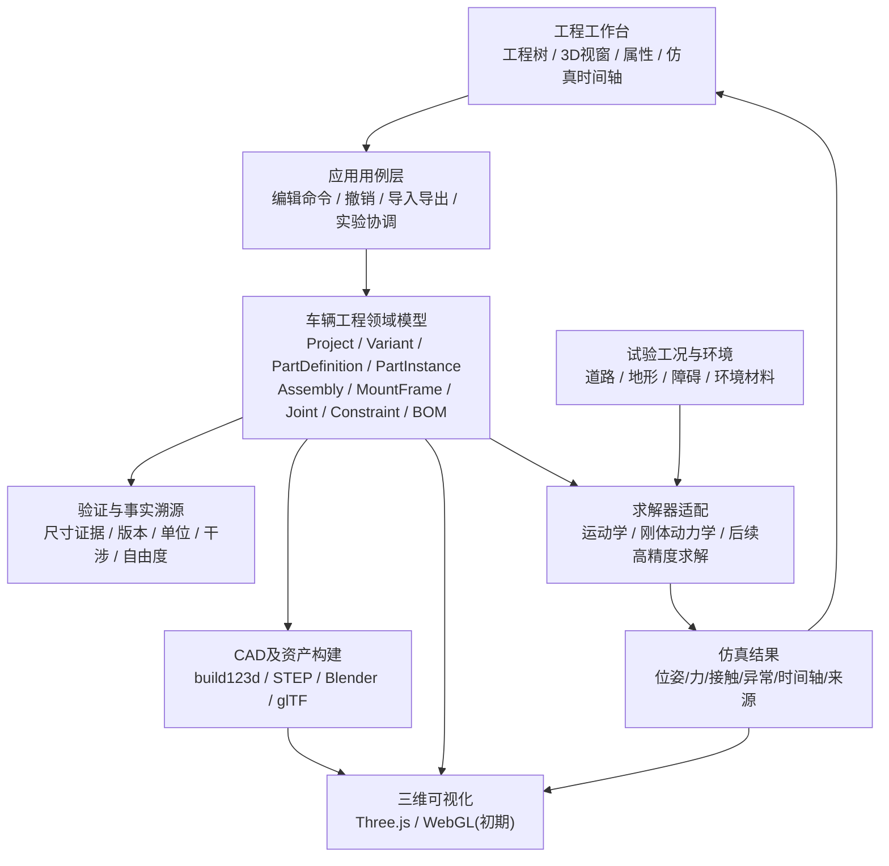

# CARLAB｜整车工程蓝图 V1（用户确认方向后的研究草案）

> **状态：DRAFT / 非生产接口规范；日期：2026-11-15；责任：GPT-6（RP-07）**
>
> 本草案深化现有 `MASTER_PLAN.md` 和 `docs/planning/PLANNING_PROGRAM.md`，不覆盖其它 AI 正在修改的总体计划，不宣称原型已具备全部能力。它首先固定用户已经确认的**产品方向**，详细接口、仿真器选择、计算真实性和工程参数仍需要研究、独立审核与 ADR 决策。
>
> 产品源点：**用户应该能从一个空白车辆工程开始，建立或引用零件、定义装配与运动关系、赋予有来源的物理属性、验证、运行仿真、观察及记录结果，并且未来让同一辆车进入不同道路和地形场景。**

## 1. 产品定义和非目标

**CARLAB 是可扩展的车辆工程建模与仿真工作台，不是固定的汽车 3D 演示。** 浏览器负责工程交互、显示、配置、实验和结果回放；参数化 CAD 与复杂求解可在本地服务/离线进程独立执行。用户使用 Chrome，不必须安装 Blender；负责生成 CAD 的开发环境可以安装 Blender/build123d。

早期聚焦**一辆可用少量真实/明确假设零件逐步装出来的示例车辆**，重点是正确性与可扩展性。最初先完成一个轮端—转向—悬架纵切样板，再扩到双前轮、整车和多车型。越野、城市、交通流、碰撞、结构强度属于其上的后续场景/能力，不因远景过大而假称已实现。

不得混淆：
- `CAD exact geometry`、`Render mesh`、`Collision proxy`：三种不同的数据资产，不能互相当作证据。
- `Kinematics`（给定运动输入求约束位姿）、`Rigid-body dynamics`（受力与质量求时域运动）、`Deformable/FEA`（结构/连续体变形）：能力与计算成本不同。
- `演示动画`、`可复算算法输出`、`经真实资料校准的工程仿真`：必须分别标记，不随界面美观升级可信度。
- 物理产品树、功能树、界面导航树、开发任务树不是同一棵树。车辆悬架是工程子系统，**不应被硬编码成与“整车模式”平级的永久主导航页**。

## 2. 从零造车的完整用户闭环（核心验收）

用户启动 CARLAB：

1. **创建工程**：选择空白工程或现成模板，定义单位、坐标、车型/平台、版本和真实性目标；允许选择空白底盘、初始轮端模板，而不是强迫套现有车。
2. **添加和替换零件**：从零件库选择零件族、型号/变体；或通过 CAD 参数生成并导入。每个零件实例有唯一身份，选择/隐藏/独立观察/查证据；无尺寸证明的演示件显式 `UNKNOWN/DEMO`。
3. **建立总成**：编辑零件局部安装基准、父子关系、固定/铰/滑动等机械约束、连接/限位，形成 BOM 和运动图；重复螺栓为多个实例，不是一块不可拆网格。
4. **检查设计**：单位和坐标、接口相容性、同款不同代际别名、尺寸来源、静态装配、关键间隙/硬碰撞、运动范围碰撞、约束自由度、欠/过约束。失败时指出**零件、具体约束、证据和修复建议**，不能只报一个代码。
5. **操作与模拟**：选择关节驱动/转向/悬架行程等，运行运动学；有质量、惯量、弹簧阻尼/接触模型时才启用对应动力学。仿真结果带模型版本、工况版本、时间轴、错误/不确定度标签，可暂停、回放和导出。
6. **观察与分析**：可选择结构部件、自动定位镜头、剖切、透明、爆炸、测量、对比设计前后、显示运动轨迹与最小间隙。界面选择一个部件后，统一驱动 CAD/模型树/属性/仿真高亮，避免页面之间各自维护零件列表。
7. **修改/变型/保存**：改轮距/轴距、换悬架与动力总成触发影响分析、增量 CAD 构建与关联检测；把几何/仿真旧结果标 `STALE`，不能让过期计算在新车型里默默有效。能撤销/重做、版本化保存、比较和恢复。
8. **以后再加载场景**：将已验证的同一车辆及可适用的物理配置放到标准试验场、越野地形或城市环境；不复制一份“越野车内部逻辑”或把新场景写进零件属性。

### 核心交互场景：首次实现必须走通

**一个双叉臂轮端纵切样板**：加载法兰、轴承（真实性按证据标注）、转向节、上下摆臂、球铰和车架硬点；给定一个悬架跳动输入；求解机构姿态，所有连接点保持约束，能显示前束/外倾或未知；检查零件相交/最小间隙；用户能点某摆臂查看安装点、运动轨迹、来源与测试状态；保存后可重放同样的结果。此样板不要求先得到完整 OEM 车型全部尺寸，缺数据时只能在 **DEMO 假设域**运行并明确提示。

## 3. 统一工程分层与真实数据流



**重要架构规则**：
- `Engineering Project` 是唯一工程事实源；Three.js 对象名、iframe 中状态、UI 面板和 Cannon-es 刚体都**不是工程主数据**。
- `RenderAdapter` 只接收 `instanceId→transform/material/visibility/selection`；资产可重新生成，工程 ID 和关节关系不丢。
- `SolverAdapter` 的输入是有版本的装配图、关节/约束、物理属性、工况/场景；输出是不污染工程源数据的 `SimulationRun`。状态可回放，不与动画循环强绑定。
- 静态装配、运动学、动力学、碰撞检测**共享相同实例 ID 与明确的局部 Frame**，但采用独立校验与求解逻辑，避免浏览器里“看起来接合”却其实拉伸 Mesh。
- `SceneDefinition` 包含环境几何、材料/摩擦/地形/天气的可说明模型；`TestCase` 包含初始车状态、控制输入与时域设置；`VehicleVariant` 和场景分离。
- 编辑引擎用声明式 Command/Result 与快照，定义状态 `editing→validated→ready→running/paused→result`；变更输入应使有关缓存/结果失效。
- 模型源数据字段遵循当前 R-02/R-07/R-10/R-12 候选研究，**本草案不冻结** `PART`、`SYS` 别名、BOM qty、左右坐标转换或 `Joint/Constraint` 分界；保留 Open Decisions。

## 4. 产品界面重新组织（不是五个平级大导航）

```
工程项目 / 车型版本 / 当前工况
┌───────────────┬────────────────────────────────────┬──────────────────────┐
│ 模型结构与资产 │            统一 3D 视窗            │ 选中对象的属性/证据    │
│ Vehicle       │                                    │ 尺寸、材料、质量       │
│ ├ Frame       │       车辆或局部总成 / 剖切           │ 装配点、Joint/约束     │
│ ├ Suspension  │       零件选中/隐藏/干涉高亮         │ 数据来源与可信等级     │
│ ├ Steering    │       相机跟随/局部视角/测量         │ 错误与可执行操作       │
│ └ Powertrain  │                                    │                      │
├───────────────┴────────────────────────────────────┴──────────────────────┤
│ 工作上下文：组装 | 检查 | 运动学 | 动力学 | 试验场 | 分析 (按能力解锁)      │
│ 时间轴 / 实验输入 / 曲线 / 约束警告 / 回放 / 保存                         │
└───────────────────────────────────────────────────────────────────────────┘
```

- **以工程对象为主导航**。选择一整车、悬架总成或单个螺栓时，左侧树与右侧属性随同一个 `selectionId` 改变。子系统通过工程树、搜索和上下文面板访问；不必给悬架/轮胎各造独立顶层页面。
- **工作模式属于操作上下文**：建模、装配、测量、检验、运行/回放。首次能力解锁时保持简单，不在界面摆满还不存在的按钮。
- **摄像机是独立系统**：自由轨道、选中零件聚焦、车辆航向跟随、车内/车外、正交/剖面；跟随基于车身完整位置+姿态，不仅平移。模式切换和用户拖动有明确定义的优先级/过渡策略。
- **一个主视窗，一套统一 selection/scene state**。初期可以在内部暂时复用旧 viewer 资产，但当前 `workbench-ui.js` iframe + 两个 Three 场景仅为过渡方案，不应作为长久工程模型架构。
- UI 风格：清爽的浅色工业软件基调，易阅读、充分留白、明暗与选中态明确，视觉性能和信息密度优先于花哨动画。

## 5. 首批软件模块边界（候选，不是冻结接口）

| 模块 | 责任 | 不能做的事 |
|---|---|---|
| `ProjectStore` | 工程、车型、对象 ID、BOM、版本/快照、编辑命令、持久化 | 不持有 Three Object3D 作为唯一工程数据 |
| `EngineeringRegistry` | PartDefinition/PartInstance/Assembly/MountFrame/Connection/Joint/Constraint 与来源 | 不用网格碰撞推断机械连接关系 |
| `AssetPipeline` | build123d/STEP/网格/Blender/GLB、哈希、缓存失效、身份映射 | 不把演示尺寸升格 OEM 证据 |
| `ValidationEngine` | 数据、约束、静态/运动干涉、可用性/过期检查 | 不把有交叉的碰撞当静态几何无条件非法（须有允许接触列表） |
| `KinematicsSolver` | 在显式硬点/运动副/驱动下求解可行位姿、自由度与误差 | 不计算没有校准数据的真实惯性力 |
| `DynamicsAdapter` | 统一物理输入/输出，支持原 Cannon baseline 和未来更专业求解 | 不将游戏级 RaycastVehicle 冒充连杆动力学 |
| `SceneRunner` | 场景、道路、地形、工况、车辆初态、控制输入 | 不修改产品 BOM/零件 CAD |
| `RenderViewport` | 相机、选中、高亮、剖切、测量、LOD、渲染 | 不成为运动/装配/证据事实源 |
| `ExperimentResults` | 可复算模拟快照、时间轴、曲线、统计、诊断 | 不在工程输入改变后显示旧结果为当前有效 |

工程真实性字段需区分 `valueBasis`、`evidence`、`fidelityTarget`、`verificationResult`、`reviewDecision`。UNKNOWN 必须显式阻塞高保真要求，但可在隔离演示档允许参数假设。

## 6. 从现有代码迁移：先可验证、再替换

**现状证据（2026-11-15 本地只读查验）**
- `src/main.js` 约 41KB，界面事件、模型状态、相机、动画和物理调度耦合。
- `src/physics/vehicleWorld.js` 用 Cannon-es 的 `RaycastVehicle`，输出车身位置/姿态和车轮数据；摆臂不是由统一关节/机械装配求解的独立动力学刚体。
- `src/workbench-ui.js` 维护第五个 iframe 工程查看器，工程对象并非全局共享。
- `styles.css` 约 27KB，后续附加覆盖规则较多；不适合以继续追加覆盖作为长期设计方式。
- **可确证的相机 Bug**：在车辆跟随分支中，主相机与控制目标仅按 `chassisPosition` 差值平移；没有使用已有 `chassisQuaternion` 更新随车朝向，所以转弯时相机没有跟转。修复应采用车体局部偏移与世界姿态变换，并有插值、手动 Orbit 接管、碰撞/阻挡边界。
- 旧四模式 `整车/轮胎/悬架/传动` 属独立演示，不能直接视为真正的装配系统功能。已验证的 CAD/求解器研究在独立目录中，不等于已接入这个页面。

**策略：strangler/渐进迁移，不在旧页面上一次性大重写**
1. **基线与可重复观测**：浏览器自动化覆盖现有 5 个页面视图，保存摄像机、载入、控制、轮端模型可见性截图与控制台错误；保留可回退 Git 提交。现在 A-00 尚有未验证项，不可跳过。
2. **定义最小工程对象快照**：从现有 RP-01/R-02/R-06/DeepSeek/Grok/Gemini 的已提交成果提取字段草案并清单冲突；先用 `fixtures/` 隔离实验验证 ID/Frame/版本，RP-07 正式裁决后才接生产层。
3. **创建 `workbench-v2/` 隔离入口**：一个 WebGL 视窗，主工程树、对象选中、属性/来源检查，读取一个已有 GLB 样件；旧 5173 不被未验证代码覆盖。
4. **轮端纵切闭环**：加载多件/BOM，选定一个可复验约束的可动机构（允许 DEMO 硬点并标示），编辑参数→静态验证→运动学求解→浏览器回放→运动过程干涉检测；所有报告能追踪零件版本。
5. **安全集成**：当新模块经过真实 Chrome 浏览器、固定步长回放和回归门禁，再逐步取代 5173 内相应旧页面；非工程级 Cannon 演示明确保留为独立可对比的旧样例。
6. **场景扩展**：只有车辆工程模型与仿真接口稳定后，才接最小测试道路→越野地形→城市；每类场景有自有模型/性能和计算等级。

**禁止**：未确认的 WebGPU 迁移、强行用同一求解器解决运动学+柔性变形+碰撞、生成几百个无来源的“真实零件”、改动其它正在执行 AI 的任务/生产源码、强制统一未裁决 Schema。

## 7. 下一轮审核/架构关口

- **G0 — 原系统基线**：5 个视图可回归、相机转弯问题有可复现失败/修复测试、项目可回滚；当前尚未完全验收。
- **G1 — 工程事实源**：独立的 Part/Instance/Mount/Joint/Constraint 关系可序列化、来源可校验、参数变更失效旧结果；需 RP-07 决议。
- **G2 — 第一轮端纵切**：至少一个可复现运动链和装配约束通过，错误输入可被拒绝，视觉与求解输出一致。
- **G3 — 仿真级别声明**：刚体动力学的受力/接触/时间步模型和测量证据具备再升级，不能由动画截图证明。
- **G4 — 场景系统**：试验工况与车型解耦，一个工程车辆可在至少两个不同场景复用，不改 PartSpec。
- **G5 — 规模/保真**：大零件数、性能/纹理/LOD、缓存与复杂接触的真实测量；后期内容。

## 8. 总控待裁决事项

- 真实零件与局部坐标来源、来源继承规则；不同代际 Gen1/Gen3 的条件别名；`Joint` 与通用 `Constraint` 边界。
- 运动学求解时出现不收敛和真实几何不可解如何区分；运动过程碰撞预算、碰撞代理与工程精细几何的对应。
- 哪个模块负责质量、转动惯量、柔性衬套、弹簧/阻尼、轮胎模型；缺数据默认降级而非假装物理真实。
- 时间尺度、确定性、记录/回放、物理工况接口和可扩展求解器服务机制。
- 仿真渲染同步与相机目标、输入路由、视窗多模式过渡方式。
- 从哪一套公开合法可引用的轴承/轮端组件开始建立 `SOURCED` 纵切证据，失败则保持演示域。

**计划后续**：此文件为 GPT-6 的 RP-07 蓝图研究输入。用户确认的是**产品目标与平台方向**；技术选型/字段/生产迁移尚待独立复验，不把草案标成已验收或已实现。
