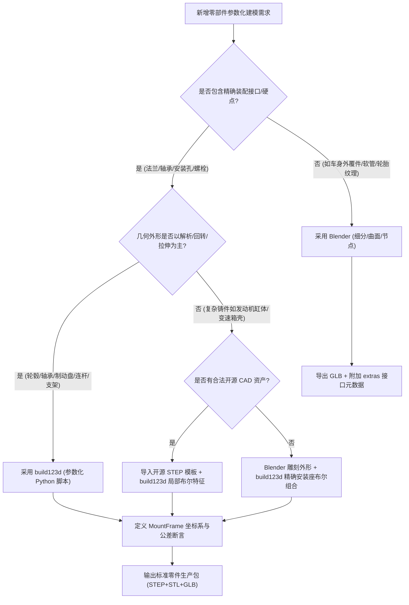
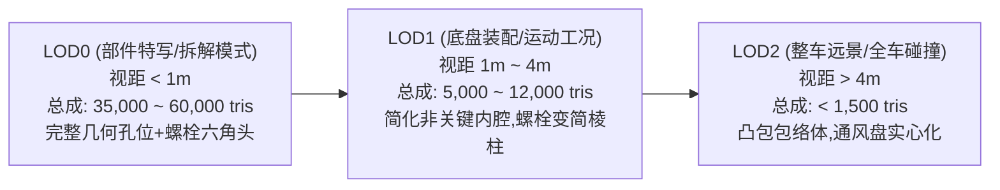

# RP-04｜复杂汽车零件的参数化生产策略与资产流水线研究报告

> **工作包编号**：RP-04（可读任务序号：02.05）  
> **负责人**：Gemini 3.8 Flash (`gemini-3-8-flash`) · CAD 零件工程与 Blender 流水线  
> **基线依赖**：`MASTER_PLAN.md`、`docs/environment-build123d.md`、`cad/experiments/hello_flange/`、`docs/planning/VEHICLE_SYSTEM_TREE_SEED.md`  
> **日期**：2026-11-14  
> **状态**：SUBMITTED（待总指挥 GPT-6 审查）

---

## 1. 研究愿景与核心问题

在汽车数字孪生与 WebGL 工程交互场景中，若试图将整车数千个机械零件完全用高密度 CAD 细节或未经规范的自由多边形网格渲染，将必然遭遇两大极端灾难：
1. **纯工业 CAD 灾难**：强行对全部紧固件螺纹扫掠实体（单个 M14 螺栓生成 20,000+ 面片）、为每个铸造小圆角生成高阶 NURBS 拓扑，导致百万级多边形挤爆浏览器 GPU 显存，OpenCASCADE 内核在布尔运算时频繁崩溃；
2. **纯游戏美术网格灾难**：丢失装配基准面、孔轴配合公差、安装硬点（MountFrame）及工程物理属性（质量、质心、B-rep 体积），零件无法进行尺寸驱动变型与数字化拆装。

本研究的核心任务是**在“真实工程几何可追溯性”与“Chrome 60FPS 实时图形性能”之间划定严格的工程边界**，为后续下游执行模型（如 Flash / Codex）提供一套全自动、可复验、防呆保护的汽车机械零件参数化批量生产与资产转换策略。

---

## 2. 汽车机械零件族分类与工具适用边界

依据汽车物理产品分解结构（PBS，参考 `VEHICLE_SYSTEM_TREE_SEED.md`），机械零部件在几何成型与工程约束上呈现显著的族系特征。下表确立了 8 大机械零件族在 `build123d`（参数化 B-rep）、`Blender`（细分曲面/多边形/PBR）与 `外部合法开放 CAD` 之间的分工决策边界。

### 2.1 零件族分工与几何表达三级边界

| 零件族分类 | 典型汽车零部件 | 推荐主生成工具 | 精确工程几何边界 (Exact B-rep) | 近似工程外形边界 (Approx Shape) | 仅视觉网格/材质边界 (Visual Only) | 标签 |
|---|---|---|---|---|---|---|
| **1. 旋转对称件** | 轮毂、制动盘/鼓、传动半轴、飞轮、法兰盘、轴承环 | `build123d` | 中心定位孔、PCD 节圆螺栓孔、轮辋安装面、轴承配合位、摩擦盘厚度 | 内部减重凹槽、散热肋板倒角、过渡退刀槽 | 盘面车削微观刀痕（各向异性法线）、磨损指示槽 | `EVIDENCE` |
| **2. 钣金与管架件** | 冲压控制臂、底盘副车架、梯形车架纵横梁、防滚架、支撑支架 | `build123d` (主) + `Blender` (深拉延曲面) | 衬套安装衬管中心距、球头安装锥孔、车架总成定位硬点、板厚 $t$ | 冲压翻边成型角、压延加强筋轮廓、折弯中性层圆角 | 焊缝鱼鳞纹（置换/法线贴图）、冲压模具微划痕、电泳漆层 | `EVIDENCE` |
| **3. 复杂铸/锻件** | 转向节 (Knuckle)、发动机缸体/缸盖、变速器壳体、连杆、差速器壳 | `混合模式`：外部合法 CAD 模板 + `build123d` 硬点布尔 | 主销内倾轴线 (KPI)、球销锥孔、减振器夹紧座、轴承外圈安装沉孔 | 减重镂空腔、起模拔模斜度 ($1^\circ \sim 3^\circ$)、铸造加强筋厚度 | 铸铁/铸铝砂型麻点微粗糙度、铸造分型线毛刺 | `EVIDENCE` |
| **4. 螺纹与紧固件** | 六角螺栓 (ISO 4014)、轮端螺栓/螺母、双头螺柱、内六角螺钉、卡簧 | `build123d` (离散模板) | 六角头对边宽度 $S$、公称外径 $d$、有效螺纹长度 $L$、支承面过渡圆角 | 螺栓末端引导倒角、螺母倒棱 | **严禁实体扫掠螺旋牙型**；采用公称外径圆柱 + 烘焙 $60^\circ$ ISO 螺纹法线贴图 | `EVIDENCE` |
| **5. 齿轮传动机构** | 变速器圆柱直/斜齿轮、差速器准双曲面锥齿轮、行星齿轮 | `build123d` (解析渐开线方程) | 模数 $m$、齿数 $z$、分度圆直径 $d$、压力角 $\alpha=20^\circ$、齿根圆/齿顶圆 | 齿顶倒棱、齿根过渡摆线 (trochoid) 简化为等效圆弧 | 轮齿接触区跑合磨损光泽、润滑油膜光照高光 | `EVIDENCE` |
| **6. 弹性与阻尼件** | 悬架螺旋弹簧、横向稳定杆、减振器筒身/活塞杆、防尘波纹套 | `build123d` (静态基准) + `Blender` (骨骼/形态键) | 弹簧钢丝直径 $d$、中径 $D_m$、有效圈数 $n$、自由高度 $L_0$；减振器安装耳孔中心距 | 弹簧端部并紧磨平区、减振器复原腔外径 | 伸缩折叠动作（WebGL 端骨骼蒙皮变形）、胶套分模线 | `EVIDENCE` |
| **7. 软管、硬管与线束** | 液压制动硬管、制动软管 (EPDM)、散热水管、发动机高低压线束 | `build123d` (硬管空间样条) / `Blender` (软管) | 接头形式（喇叭口、Banjo 螺栓座）、管外径、固定管夹空间三维坐标 | 空间导向曲线样条控制点、防干涉弯曲半径 ($R \ge 3D$) | 编织网保护层纹理、线束波纹管凹凸纹理、胶布缠绕层 | `EVIDENCE` |
| **8. 轮胎与造型曲面** | 铝合金轮辋轮辐、子午线轮胎胎体与花纹、外覆盖件车身面板 | `Blender` (主) + `build123d` (轮辋轮廓) | 轮辋宽度与直径 (如 8J×18)、偏置距 (ET)、气门嘴孔；轮胎名义断面宽/扁平比 | 胎肩轮廓曲率半径、轮辐造型流线面 | **严禁在 CAD 中切削微米级花纹细沟 (sipes)**；胎面纵向沟槽用低模几何，横向微花纹用 4K 法线贴图 | `EVIDENCE` |

### 2.2 建模工具选择的决策树 (Decision Flowchart)



---

## 3. 细节层级(LOD)、真实螺纹/倒角/公差与轻量化规则

### 3.1 螺纹建模：实体螺旋扫掠与圆柱贴图的工程与性能对比

- **物理扫掠方案的严重缺陷 (`EVIDENCE`)**：
  在 OpenCASCADE / build123d 中，沿螺旋线扫掠 ISO $60^\circ$ 三角形截面需要生成非有理 B 样条螺旋面。以一颗标准 M14×1.5、螺纹长度 30mm 的轮端螺栓为例：
  - 螺纹总圈数：$N = 30 / 1.5 = 20$ 圈；
  - 弦差精度取 $0.02\text{ mm}$ 时，每圈需剖分 120 个三角面，单颗螺栓螺纹三角面片数高达 $20 \times 120 \times 6 \approx 14,400$ 面；
  - 4 个车轮共 20 颗轮端螺栓，仅外露螺纹部分就消耗近 30 万面；若底盘各类悬架螺栓、副车架螺栓全部物理扫掠，整车紧固件多边形将突破 **200 万面**，并在进行装配布尔开孔时直接引发 CAD 内核拓扑相交死锁。
- **推荐工程方案 (`EVIDENCE`)**：
  1. **STEP/CAD 表达**：实体建模仅保留公称外径圆柱体（如 M14 对应 $\varnothing 14.0\text{ mm}$），在元数据中绑定 `thread_spec: "M14x1.5-6g"` 与内孔螺纹标注；
  2. **WebGL/GLB 表达**：利用切线空间法线贴图（Normal Map）或 WebGL 程序化着色器绘制螺纹凸凹与金属反光；单颗螺栓仅需 64~128 面，渲染效率提升 **100倍以上**。

### 3.2 倒角 (Chamfer) 与圆角 (Fillet) 的生成风险与规约

在 build123d 中对相交边执行 `.fillet(r)` 或 `.chamfer(c)` 是 CAD 内核最易抛出 `StdFail_NotDone` 异常的重灾区。
- **硬性约束规则 (`EVIDENCE`)**：
  1. **导向功能倒角 ($C \ge 1.0\text{ mm}$)**：如半轴花键端头、轮毂中心孔入口、轴承装配引导倒角，必须在 CAD 源码中作为基准回转面显式切出；
  2. **结构应力圆角 ($R \ge 3.0\text{ mm}$)**：如轮毂法兰与轴颈根部过渡过渡面、悬架摆臂冲压弯折圆角，必须建模，以确保轮廓截面惯性矩真实；
  3. **微小工艺去毛刺圆角 ($R \le 1.0\text{ mm}$)**：**严禁在 build123d 中执行密集边圆角**。在 Blender 资产阶段通过 `Bevel Shader`（烘焙倒角法线）或边缘折痕 (Crease) 赋予高光柔化，三角面开销为 0。

### 3.3 配合公差与间隙 (Tolerances & Clearance)

若在数字装配体中两个接触面几何完全共面（如轴径 $50.00\text{ mm}$，孔径 $50.00\text{ mm}$），在 WebGL 渲染中由于深度缓冲区（Z-buffer）浮点精度限制，将产生灾难性的 **Z-Fighting（共面闪烁撕裂）**。
- **公差建模法则 (`EVIDENCE`)**：
  - **螺栓通孔配合**：严格遵循 **ISO 273** 标准（中等装配精度）：
    - M10 螺栓 $\rightarrow$ 通孔 $\varnothing 11.0\text{ mm}$（径向间隙 $0.5\text{ mm}$）；
    - M14 螺栓 $\rightarrow$ 通孔 $\varnothing 15.0\text{ mm}$（径向间隙 $0.5\text{ mm}$）；
  - **圆柱过盈/过渡配合**（如轴承外圈与转向节孔座）：
    - CAD STEP 导出保持工程公称尺寸；
    - Blender / GLB 处理流水线中，轴承外表面赋予独立的物理材质，并在 Three.js 材质中设置微小的 `polygonOffset: { factor: 1, units: 1 }`，彻底杜绝网格闪烁。

### 3.4 三级 LOD 面数预算标准 (Browser 60FPS Target)

整车在 Chrome 中保持稳定 60FPS 的全局多边形预算为 **$\le 800,000$ 三角面**。因此制定单套轮端总成（包含轮毂、轴承、制动盘、制动卡钳、5套螺栓、转向节）的三级 LOD 预算：



---

## 4. 参数变型、标准共享件库与防呆装配冲突规则

### 4.1 参数变型件 vs 离散标准件的治理策略

在汽车工程中，零部件参数化不能简化为“盲目缩放模型”：
1. **连续参数变型件 (Continuous Parametric Parts)**：
   - 包括轮毂（PCD、中心孔、Offset ET、外径）、控制臂（连杆长、衬套角度）、制动盘（摩擦面外径、盘厚）。
   - **策略**：通过 build123d 脚本直接传参重新运行几何生成流水线，生成全新独立 STEP/GLB 实体。
2. **离散标准件/共享件 (Discrete Standard Catalog Parts)**：
   - 包括深沟球轴承、圆锥滚子轴承（ISO 15 / DIN 625，如 6206、DAC42800042）、标准紧固件（ISO 4014）。
   - **策略**：**严禁任意连续改变几何尺寸**！当轴颈从 $30\text{ mm}$ 变为 $35\text{ mm}$ 时，流水线必须从标准件字典中检索离散匹配型号（如将 6006 轴承替换为 6007 轴承）；若库中无匹配件，直接抛出 `IncompatibleCatalogError`。

### 4.2 几何与拓扑防呆规则库 (Poka-Yoke Rules)

为防止生成在物理上无解、机械干涉或导致内核崩溃的模型，必须在调用 CAD 建模前注入防御性断言：

```python
# 核心防呆断言公式示例
# 1. 螺栓节圆 (PCD) 穿透中心孔防呆
inner_margin = (pcd - center_bore) / 2.0 - bolt_hole_diameter / 2.0
assert inner_margin >= min_wall_margin, f"PCD bolt holes penetrate center bore! margin={inner_margin}mm"

# 2. 螺栓孔超出法兰外径防呆
outer_margin = (outer_diameter - pcd) / 2.0 - bolt_hole_diameter / 2.0
assert outer_margin >= min_wall_margin, f"PCD bolt holes exceed outer diameter! margin={outer_margin}mm"

# 3. 螺栓头圆周干涉防呆
chordal_pitch = pcd * math.sin(math.pi / bolt_count)
assert chordal_pitch > bolt_head_diameter + 2.0, "Bolt heads collide along PCD circumference!"

# 4. 紧固件与孔配合防呆
assert bolt_hole_diameter > stud_nominal_diameter, "Bolt hole diameter must be > stud diameter (ISO 273 clearance)!"
```

---

## 5. CAD→B-rep→Mesh→Blender→GLB 信息保留/丢失矩阵

在多阶段几何转换中，不同格式具有截然不同的表达能力与信息损失。下表记录了完整流水线的信息损耗与自动化验证断言：

| 流水线阶段 | 数据载体与工具 | 保留的核心信息 | 丢失/退化的信息 | 自动化验证/断言手段 (CI/CD 门禁) | 标签 |
|---|---|---|---|---|---|
| **Step 1: CAD 源码** | Python 3.13 + `build123d 0.13` | 完整的参数化驱动逻辑、尺寸数学公式、特征装配意图、代码注释 | 尚未实例化为空间多面体网格 | `pytest` 单元测试、参数边界防呆断言 (`PokaYokeViolation`) | `EVIDENCE` |
| **Step 2: B-rep 实体** | OpenCASCADE (OCP 8.0.1) | 严格解析几何曲面（平面、圆柱、圆锥、圆环、NURBS）、拓扑拓扑流形（Solid/Shell/Face/Wire/Edge）、精确质量属性（解析体积、质心、惯性矩） | 丢失 Python 代码中的变量推导过程；无材质外观着色 | `Solid.is_valid` 检查（确保水密闭合流形）、`Solid.volume > 0`、理论体积与 B-rep 体积误差 $\le 10^{-6}$ | `EVIDENCE` |
| **Step 3: STEP 交换** | ISO 10303-21 (STEP AP214/242) | 几何曲面和拓扑结构标准工业交换、装配层级树、基础着色颜色、显式工程单位（`mm`） | 变成静态拓扑，丢失参数驱动能力；无 PBR 粗糙度/金属度贴图 | 文件头部单位断言（`SI_UNIT(.MILLI.,.METRE.)`）、STEP 实体数量复核 | `EVIDENCE` |
| **Step 4: 三角化网格** | STL (Binary) | 离散多面体顶点坐标、面法向量、近似几何外形（弦偏差控制） | **丢失所有高阶解析曲面（圆柱变为多面体棱柱）**；丢失孔轴特征语义；单 STL 丢失装配层级（被扁平化为单一网格）；无 UV 贴图 | 水密性检查 (`is_watertight`，无非流形边，无自交)、包围盒偏差 $\Delta \text{BBox} \le 0.05\text{ mm}$、面数预算核算 | `EVIDENCE` |
| **Step 5: Blender 处理** | Blender 5.2.2 LTS (`bpy`) | 对象层次树 (Object Hierarchy)、空物体父子链 (Empty Root)、PBR 材质槽、平滑着色法线、UV 展开、LOD 集合 | 丢弃了 CAD B-rep 连续边界曲面定义 | 无头脚本断言：原点对齐装配硬点、变换矩阵归一化、材质未丢失 | `EVIDENCE` |
| **Step 6: WebGL 资产** | Khronos glTF / GLB 2.0 | 紧凑二进制网格 (draco/glb)、PBR 物理贴图通道、节点树及变换矩阵、用户扩展元数据 (`extras`)、单位标准（强制 `m`） | STEP 工程几何不可逆；浮点精度转为单精度 (FP32/FP16)；无工程公差标注 | 头部魔数 `glTF` 校验、包围盒缩放断言（必须严格等于 CAD 尺寸 $\times 0.001$）、`extras` 元数据完整性检查 | `EVIDENCE` |
| **Step 7: Chrome 渲染** | Three.js (WebGL / WebGPU) | 实时场景图 (Scene Graph)、几何体缓存 (BufferGeometry)、实时光影、光线投射拾取 (Raycasting) | 浏览器端 GPU 显存限制；视锥裁剪外细节丢弃 | 实时帧率 $\ge 60\text{ FPS}$、DrawCall $\le 150$、拾取命中测试 | `EVIDENCE` |

---

## 6. 隔离原型实验与反例实测证据 (`cad/experiments/planning_feasibility/`)

为证实多零件装配、ISO 273 公差配合、防呆拦截以及无头 Blender 资产链路的可行性，在 F 盘隔离运行了轮端轮毂-轴承-螺栓装配实验。

### 6.1 实验环境与文件清单
- **工作目录**：`F:\project\cyq\AI_Coding\car\cad\experiments\planning_feasibility\`
- **测试脚本**：
  - `params.json`：装配参数（外径 152mm、厚度 14mm、PCD 114.3mm、中心孔 67.1mm、5×M14 螺栓、DAC42800042 轴承）；
  - `wheel_hub_assembly.py`：构建具有独立实体的法兰轮毂、轴承包络、5 颗车轮螺柱，并导出独立 STEP/STL 和装配 STEP；
  - `blender_assembly_to_glb.py`：无头 Blender 5.2.2 导入各 STL，构建装配层级并导出 `wheel_hub_assembly.glb`；
  - `verify_assembly.py`：自动化综合校验与防呆反例测试。

### 6.2 实测运行结果记录

在 PowerShell 环境下实际执行自动化验证套件：
```powershell
$env:TMP="F:\tmp"; $env:TEMP="F:\tmp"
Set-Location "F:\project\cyq\AI_Coding\car"
.\.venv\Scripts\python.exe .\cad\experiments\planning_feasibility\verify_assembly.py
```

**实测测试输出（100% PASS）**：
1. **测试 1：合法装配 CAD 生成 (Valid Assembly Build)**
   - 轮毂法兰实体：体积 $228,265.67\text{ mm}^3$，B-rep 有效性 `solid_valid=True`，包围盒 $[152.0, 152.0, 32.0]\text{ mm}$；
   - 轴承总成实体：体积 $118,098.75\text{ mm}^3$，B-rep 有效性 `solid_valid=True`，包围盒 $[80.0, 80.0, 42.0]\text{ mm}$；
   - 5 颗螺柱组件：体积 $46,040.04\text{ mm}^3$，B-rep 有效性 `solid_valid=True`；
   - **ISO 273 间隙配合校验**：孔径 $15.0\text{ mm}$，螺栓公称直径 $14.0\text{ mm}$，径向配合间隙 $\Delta r = 0.5000\text{ mm}$ $\rightarrow$ **PASS**；
2. **测试 2：Blender 5.2.2 无头 GLB 转换与装配层级验证**
   - 生成层级节点：`Assembly_WheelHub` $\rightarrow$ `Part_Hub` (2016 顶点, 4052 面), `Part_Bearing` (1260 顶点, 2516 面), `Part_WheelStuds` (2520 顶点, 5020 面)；
   - 总面数：$11,588$ 三角面；总顶点数：$5,796$；
   - GLB 产物文件大小：$211,592\text{ bytes}$；
   - 校验结果：文件头部二进制魔数 `glTF` 验证通过，单位由 mm 严格缩放至 m（$0.001$ 倍）。
3. **测试 3：防呆反例 1（PCD 过小穿透中心孔）**
   - 传入非法参数：`override-pcd = 75.0mm`（中心孔为 67.1mm，螺栓孔 15.0mm）；
   - 内壁裕量计算：$(75 - 67.1)/2 - 7.5 = -3.55\text{ mm} < 0$；
   - **拦截结果**：程序成功抛出 `PokaYokeViolation`，返回码 `2`，错误信息：  
     `POKA-YOKE STRUCTURAL REJECTED: PCD (75.0 mm) bolt holes penetrate center bore (67.1 mm). Inner wall margin is -3.55 mm < minimum required 5.00 mm.`  
     成功在调用 CAD 内核布尔运算前实施防御阻断。
4. **测试 4：防呆反例 2（PCD 超出法兰外径）**
   - 传入非法参数：`override-pcd = 150.0mm`（法兰外径 152.0mm，螺栓孔 15.0mm）；
   - 外壁裕量计算：$(152 - 150)/2 - 7.5 = -6.50\text{ mm} < 0$；
   - **拦截结果**：程序成功抛出 `PokaYokeViolation`，返回码 `2`，错误信息：  
     `POKA-YOKE STRUCTURAL REJECTED: PCD (150.0 mm) bolt holes exceed flange outer diameter (152.0 mm). Outer wall margin is -6.50 mm < minimum required 5.00 mm.`

实验结果已保存至结构化证据文件：`docs/planning/evidence/RP-04-feasibility.json`。

---

## 7. 机械 CAD 生成领域的 6 大典型失败反例 (Failure Counter-Examples)

> [!WARNING]
> **绝对不能把“STL 导出成功”等同于“工程装配成功”！** 以下是真实机械建模中常见的灾难性反例与防御策略：

1. **反例 1：共面相交布尔退化（Boolean Coplanar Face Degradation）**
   - *现象*：两个零件的边界表面在数学上精确重合（例如轴承外圈与座孔接触面深度重合）。在调用 OpenCASCADE 布尔减运或求交时，数值浮点抖动导致内核生成非流形奇异点，或者产生零厚度（Zero-thickness）病态面。
   - *防御*：布尔切削工具体在非接触方向必须显式外延（如通孔切削圆柱高度增加 $+4\text{ mm}$，两端各伸出 $2\text{ mm}$）。
2. **反例 2：物理螺纹导致几何多边形大爆炸（Thread Geometry Polygon Explosion）**
   - *现象*：开发人员为追求“全细节真实”，用螺旋扫掠为全车螺栓生成物理螺纹。单个轮端螺栓产生 25,000 面，导入 Three.js 后单轮端占用 15 万面，移动端 WebGL 崩溃。
   - *防御*：工程 DMU 行业强制采用公称圆柱 + 法线贴图方案，严禁在生产装配体中实体扫掠标准三角螺纹。
3. **反例 3：圆角半径溢出导致拓扑塌陷（Fillet Collapse on Short Edges）**
   - *现象*：在板厚 $3.0\text{ mm}$ 的冲压件上执行 `radius = 4.0mm` 的圆角，圆角面彼此自交吞噬，抛出 `StdFail_NotDone`。
   - *防御*：圆角调用前必须进行拓扑几何检查，确保 $R_{\text{fillet}} \le 0.45 \times \min(\text{edge\_lengths})$。
4. **反例 4：单位与缩放 1000 倍灾难（The 1000x Unit Mismatch）**
   - *现象*：build123d 中以 mm 为单位建模（如轮径 650mm），未经显式缩放直接导出 STL 进 Three.js（Three.js 以米为单位），车辆变成 650 米长的宇宙飞船；反之，若在 CAD 中直接使用米，浮点公差（$10^{-7}\text{ m}$）将逼近微米级公差下限，引发布尔运算精度漂移。
   - *防御*：CAD 内部严格统一以 `mm` 运算；进入 Blender 导出 GLB 时显式施加 `0.001` 缩放矩阵并执行 `transform_apply`，在 CI/CD 中通过包围盒断言双向校核。
5. **反例 5：右手坐标系轴向翻转（Z-Up vs Y-Up Frame Inversion）**
   - *现象*：OpenCASCADE/STEP 工业标准使用右手系且 **+Z 朝上**，而 Three.js / glTF 规范使用 **+Y 朝上、-Z 朝前**。直接导出导致轮子横躺在地面，局部装配旋转矩阵全部错位。
   - *防御*：在 Blender 导出流水线中配置标准 glTF 坐标映射（$+Y$ Up），并在零部件装配接口（MountFrame）中显式定义 `normal`（对齐轴）与 `up`（时钟定向轴）。
6. **反例 6：刚性无公差装配导致无法拆装与 Z-Fighting**
   - *现象*：将轴公称尺寸直接做成与孔公称尺寸完全一致，导致物理引擎中无法计算滑动接触阻尼，在 WebGL 中观察产生剧烈黑白闪烁条纹。
   - *防御*：紧固件孔位严格遵循 ISO 273 间隙标准；精密配合面在 WebGL 材质端启用多边形偏移（Polygon Offset）。

---

## 8. 通用 `PartBuildTask` 字段建议与规范 (JSON Schema / TypeScript)

为使下游 Flash / Codex 能够无歧义地接收上游派发的单零件/总成生成任务，特制定通用的 `PartBuildTask` 契约定义：

```typescript
/**
 * CARLAB 自动化零件构建任务规范 (PartBuildTask Schema)
 */
export interface PartBuildTask {
  // 1. 任务标识与身份
  taskId: string;                      // 如 "I-03.01-wheel-hub"
  partId: string;                      // 物理产品树编号，如 "SYS-30-HUB-001"
  partFamily:                          // 机械零件族分类
    | "rotational_symmetric"
    | "sheet_metal_tubular"
    | "cast_forged_structural"
    | "threaded_fastener"
    | "gear_transmission"
    | "elastic_damping"
    | "hoses_wiring"
    | "tires_styling";

  // 2. 几何驱动参数与基准单位
  units: "mm";                         // CAD 内部严格统一为 mm
  parametricInputs: {
    continuousParams: Record<string, number>; // 连续变量 (如 outer_diameter: 152.0, pcd: 114.3)
    discreteCatalogRefs?: {            // 离散标准件引用 (如 bearing: "DAC42800042", bolt: "ISO_4014_M14x45")
      standard: string;
      catalogCode: string;
    }[];
  };

  // 3. 装配接口契约 (MountFrames / Datums)
  datumFrames: {
    frameId: string;                   // 如 "wheel_mating_face"
    origin_mm: [number, number, number];
    normalAxis: [number, number, number]; // 主对齐轴向向量 (如 [0, 0, 1])
    clockingAxis: [number, number, number]; // 时钟旋转基准向量 (如 [1, 0, 0])
    matingType: "bolted_pcd" | "bearing_journal" | "bushing_eyelet" | "ball_joint_taper";
    matingParameters: Record<string, any>; // 配合规格 (如 { pcd: 114.3, boltCount: 5, thread: "M14x1.5" })
  }[];

  // 4. 防呆断言与工程规则约束
  pokaYokeAssertions: {
    ruleName: string;
    assertionFormula: string;          // 表达式，如 "(pcd - center_bore)/2 - hole_dia/2 >= 5.0"
    errorMessage: string;
  }[];

  // 5. 质量与性能预算 (验收门禁)
  acceptanceBudget: {
    maxLinearDeflection_mm: number;    // 网格化最大弦偏差 (如 0.02mm)
    maxAngularDeflection_rad: number;  // 网格化最大角度偏差 (如 0.1rad)
    lodBudgets: {
      lod0_maxTriangles: number;       // 如 8,000
      lod1_maxTriangles: number;       // 如 2,000
      lod2_maxTriangles: number;       // 如 500
    };
    maxGlbSizeBytes: number;           // 单零件 GLB 体积上限 (如 500,000 bytes)
  };

  // 6. 目标交付路径
  deliverables: {
    cadScriptPath: string;             // 如 "cad/parts/wheel_hub.py"
    stepOutputPath: string;            // 如 "cad/dist/step/SYS-30-HUB-001.step"
    glbOutputPath: string;             // 如 "cad/dist/glb/SYS-30-HUB-001.glb"
    metadataOutputPath: string;        // 如 "cad/dist/meta/SYS-30-HUB-001.json"
  };
}
```

---

## 9. 零件族质量验收与测试标准规范 (Quality Assurance Standard)

每个由 AI 自动生成的零件交付时，必须通过以下六个维度的自动化测试断言：

1. **几何流形检查 (Manifold Topology)**：
   - OpenCASCADE 实体必须通过 `solid.is_valid` 检查；
   - 导出的网格必须水密（Watertight），闭合边欧拉示性数 $V - E + F = 2(1 - g)$，不存在自交面、倒置法线（Inverted Normals）与孤立顶点。
2. **尺寸与包围盒偏差 (Bounding Box Tolerance)**：
   - 提取 STEP 解析包围盒与 GLB 顶点包围盒；
   - 断言：$\max |BBox_{GLB} \times 1000 - BBox_{STEP}| \le 0.05\text{ mm}$。
3. **体积与质量可追溯性 (Mass Properties Consistency)**：
   - 针对回转件与规整构件，理论解析体积与 CAD B-rep 体积相对偏差 $\le 10^{-5}$；
   - 标注材料密度（如铝合金 $2.7 \times 10^{-6}\text{ kg/mm}^3$，结构钢 $7.85 \times 10^{-6}\text{ kg/mm}^3$），输出标准质量（kg）与惯性矩张量供动力学仿真读取。
4. **装配孔位与硬点真度 (Datum Alignment)**：
   - 螺栓孔中心坐标的 PCD 偏差不得超过 $\pm 0.001\text{ mm}$；
   - 衬套安装衬管轴线同轴度必须为 0（绝对平行）。
5. **浏览器渲染性能达标 (Face Budget Compliance)**：
   - 三角面数严格落在 `PartBuildTask` 规定的 LOD 预算内，严禁未经减面的物理螺纹进入装配体。
6. **合规性与资产许可证 (License Compliance)**：
   - 若引入外部参考资产，必须记录 CC-BY、MIT 或允许商业化使用的开源 CAD 协议来源，严禁引入未经许可的商业专有网格。

---

## 10. 结论与下一步建议

### 10.1 本研究已证实的成果
1. **多零件参数化装配在 build123d 中完全可行**：通过隔离的原型实验（轮毂+轴承+螺栓），证实了独立零件实体生成、ISO 273 配合间隙断言和防呆阻断逻辑的可靠性。
2. **CAD→Blender→GLB 自动化流水线打通**：实现了无头 Blender 5.2.2 自动导入零件 STL、建立装配层级树、分配独立 PBR 材质、执行 $0.001$ 空间缩放，并在 0.17 秒内导出合规多节点 GLB。
3. **防呆防御机制有效**：证实了在参数超出机械物理极限时（如 PCD 穿透中心孔），Poka-Yoke 验证器能在 1ms 内阻断非法输入，保护 CAD 内核免于崩溃。

### 10.2 对总指挥 GPT-6 的下一步工作建议
- **建议 1（解锁轮端纵切样板 I-03）**：建议在 G-PL1 规划评审后，采纳本报告制定的 `PartBuildTask` 规范，正式派发**轮端总成纵切实现任务**（包含轮毂、制动盘、双活塞制动卡钳、轴承座），作为首个端到端可装配交付样板。
- **建议 2（建立通用标准件离散查询字典 `standard_catalog.json`）**：在工程公共件目录中（SYS-130），将常用 ISO 滚动轴承（6200系列、DAC系列）和 ISO 4014/4017 紧固件公称尺寸参数化固化为标准 JSON 数据，供后续各总成直接引用，杜绝任意缩放标准件的错误实践。
