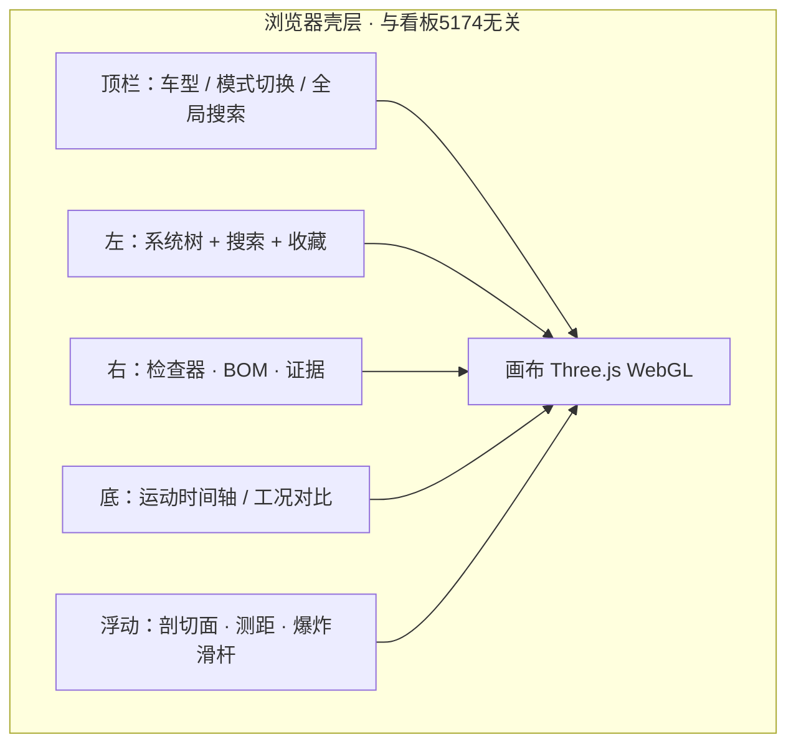

# RP-06｜浏览器工程查看与学习体验规划

> 版本：2026-11-14 · Composer 2.5 · `status: SUBMITTED（待总控审核）`  
> 关联：`MASTER_PLAN.md` §2–5、`docs/planning/VEHICLE_SYSTEM_TREE_SEED.md`、`docs/planning/PLANNING_PROGRAM.md`  
> 证据文件：`docs/planning/evidence/RP-06-*.json`  
> **EVIDENCE**：本报告基于 2026-11-14 对本机可读项目文件的审计；**未修改** `src/` 与看板代码。

## 0. 执行摘要（非程序员可读）

CARLAB 在 Chrome 里应提供**两类并列体验**：**工程查看模式**帮助用户按系统树理解装配、参数与证据；**高画质展示模式**强调材质与光影，但不得掩盖尺寸/运动/仿真的可信度等级。现有「小车工程工坊」四页签（整车/轮胎/避震/传动）是**子系统摄影棚演示** `EVIDENCE`，还不是按 PBS 导航的整车工程查看器。本报告给出用户旅程、双模式取舍、Three.js 能力对照、真实性标注规范、信息架构、性能验收方案，以及 MVP/LATER/RESEARCH 分级，供下游直接拆前端实现任务。

---

## 1. 现状审计（事实 vs 缺口）

| 项 | 判定 | 依据 |
|---|---|---|
| 四演示模式可运行 | `EVIDENCE` | `src/specs.js` 中 `STUDIO_MODES`；`index.html` 模式页签；`npm start` → `http://localhost:5173/` 返回 HTTP 200（2026-11-14） |
| 工程单位约定 | `EVIDENCE` | `MASTER_PLAN.md` §4.1：CAD mm，浏览器 m/kg/s/N |
| 按 instanceId 选零件/BOM | `OPEN` | `MASTER_PLAN.md` §4.2–4.3 已定义契约；`src/` 仍为程序化网格，无 GLB 实例树 |
| 与 AI 指挥看板分离 | `EVIDENCE` | `AGENTS.md` §4：`npm run dashboard` → 5174，汽车演示 5173 |
| 剖切/测距/爆炸/变型对比 | `MISSING` | 当前 `main.js` 无对应交互；仅 OrbitControls + 模式工具栏 |

**结论**：RP-06 交付的是**产品工作流与 IA**，不假定上述能力已实现；实现应走**新模块/新路由**，保留四模式回归（`MASTER_PLAN.md` P0）。

---

## 2. 核心用户旅程（8 步闭环）

与任务书一致，并映射到 PBS 种子 `SYS-00`…`SYS-140`：

```text
① 整车浏览          → 选定车型/变型（PlatformFamily + Variant）
② 总成定位          → 系统树 / 搜索 → 飞至总成包围盒
③ 零件选择          → 3D 点选 ⟷ 树节点双向高亮
④ 参数与材质        → 侧边「检查器」：PartSpec 参数、来源、验证等级
⑤ 爆炸 / 装回       → 沿装配轴离散，带撤销栈
⑥ 装配运动          → 关节驱动播放（区分运动学链 vs 演示动画）
⑦ 工况比较          → 变型 A/B 或配置前后（透明叠影 / 分屏）
⑧ 追溯证据          → 资料链接、CAD/GLB 哈希、测试记录、RP 报告引用
```

**学习路径（叠加）**：「引导式讲解」= 预置镜头序列 + 文字卡片，每一步绑定 `systemId` 与 `validationLevel`，禁止把讲解脚本标为已验证工程。

旅程与 UI 触点映射见证据：`docs/planning/evidence/RP-06-user-journey.json`。

---

## 3. 双模式：工程查看 vs 高画质展示

同一辆车的**数据与场景图共享**；切换模式时改变渲染配置、控件密度与默认真假性展示策略，而非加载另一份无关模型。

| 维度 | 工程查看模式（Engineering） | 高画质展示模式（Showcase） |
|---|---|---|
| 用户目标 | 理解装配、检查接口、读参数与证据 | 观感、材质、品牌级展示 |
| 背景/网格 | 中性灰底 + 可选工程网格/坐标轴 | 摄影棚 HDR/RoomEnvironment、地面反射 |
| 信息密度 | 高：系统树、BOM、检查器、测距读数 | 低：品牌条、简短规格、全屏画布 |
| 默认材质 | 可切换线框/半透明/x-ray；按 validation 着色 | 完整 PBR、阴影、后期（可选 Bloom） |
| 剖切/隔离 | 默认可用入口 | 隐藏或仅「剖面欣赏」简化版 |
| 物理/试验 | 可链到「试验台」工况，显式仿真等级 | 仅院线动画或循环镜头，无伪物理 HUD |
| 性能倾向 | 关闭昂贵后期；LOD 激进；按需加载 | 允许更高像素比、阴影分辨率、贴图 mips |
| 与旧四模式 | **并存**：四模式 = 子系统「实验室」入口 | 四模式可作为 Showcase 子场景 |

**ASSUMPTION**：首发用全局「模式开关」（顶栏 Segmented Control），而非两套独立 URL；后续可加 `?view=engineering|showcase` 深链。

**REQUIRES_RESEARCH**：整车数千零件时，Showcase 与 Engineering 是否共用同一 GLB 实例池，或 Showcase 预烘焙合并网格——需 RP-04 资产策略与 RP-03 真实性矩阵对齐后再定。

---

## 4. 大规模模型交互能力矩阵（Three.js r170）

项目依赖 `three@^0.170.0`（`package.json`）`EVIDENCE`。下表区分**现成支持**（官方示例/核心 API）与**自研**（数据层 + UI）。

| 能力 | 分类 | 技术要点 | 备注 |
|---|---|---|---|
| 系统树导航 | 自研 UI + `EVIDENCE` 数据 | PBS JSON，同步 `Object3D.userData.instanceId` | 依赖 DeepSeek RP-02 / Qwen RP-01 树 ID |
| 零件搜索 | 自研 | 扁平索引 `displayName`/`partId`/标签 | MVP 前缀匹配即可 |
| 点选高亮 | MVP 混合 | Raycaster + `OutlinePass` 或 emissive 覆盖 | 示例：`examples/jsm/postprocessing/OutlinePass.js` |
| 框选 | LATER | `SelectionBox.js` + 自定义逻辑 | 大量对象时性能需 LOD |
| 隐藏/隔离 | MVP 自研 | 遍历实例 `visible`；「隔离」= 仅显示选集+祖先 | |
| 透明/x-ray | MVP 核心 | `Material.transparent` + `depthWrite` 规则 | 需统一材质代理层 |
| 剖切 | MVP 核心 | `renderer.clippingPlanes` + `Material.clipIntersection` | [WebGLRenderer.clippingPlanes](https://threejs.org/docs/#api/en/renderers/WebGLRenderer.clippingPlanes) |
| 测距 | MVP 自研 | 两点世界坐标 + 标注 Sprite/CSS2D | 可选 `CSS2DRenderer`；单位显式 m/mm 切换 |
| BOM 面板 | 自研 | 读 Assembly `bom` + PartSpec | `MASTER_PLAN.md` §4.3 |
| 运动副显示 | REQUIRES_RESEARCH | Joint 图 → 辅助轴/弧/限位扇区 | `TransformControls` 仅适合编辑，不适合量产 UI |
| 爆炸图 | MVP 自研 | 预计算 `explodeVector` 或沿 joint 父轴位移 | glTF 不标准爆炸；存于装配 JSON |
| 变型差异 | LATER | 双 Scene 或 ghost mesh + diff 表 | 需 VariantRule 与稳定 instanceId |
| 按需加载 | MVP 官方 | `GLTFLoader` + `DRACOLoader`/`KTX2Loader` | [GLTFLoader](https://threejs.org/docs/#examples/en/loaders/GLTFLoader) |
| 视角书签/飞入 | MVP | 相机动画 + `ViewHelper` | `examples/jsm/helpers/ViewHelper.js` |
| 测量圆/角度 | LATER | 自定义 gizmo | |
| 旧四模式兼容 | 约束 | 新 Viewer **不替换** `selectMode()` 四页签 | `src/main.js` `selectMode` `EVIDENCE` |

完整分级见 `docs/planning/evidence/RP-06-feature-matrix.json`。

---

## 5. 真实性标注（防「画面精美 = 工程正确」）

采用 **MASTER_PLAN.md** §4.4 四级 `VISUAL | GEOMETRY | KINEMATIC | DYNAMIC`，并在 UI **永久可见**：

### 5.1 徽章维度（正交，可同时显示）

| 徽章 | 含义 | 典型文案 |
|---|---|---|
| 数据等级 | Part/Assembly 整体验证级别 | `几何已核对` / `仅示意外形` |
| 尺寸来源 | 参数 metadata | `有来源尺寸（ISO/厂商手册）` / `假设尺寸` |
| 运动类型 | 当前播放 | `演示动画` / `运动学` / `动力学仿真` |
| 证据状态 | 可追溯 | `已验证` + 链接 / `待验证` 灰标 |

### 5.2 视觉编码（工程模式强制，展示模式简化为角标）

- `VISUAL`：轮廓线框或淡色，检查器顶部黄色条。  
- `GEOMETRY`：实体着色 + 尺寸可读。  
- `KINEMATIC`：关节轴彩色线 + 限位标记。  
- `DYNAMIC`：HUD 显示求解器名、时间步、工况 ID（与 RP-03 对齐）。

### 5.3 误导防护规则

1. Showcase 模式进入时弹出**一次性**说明：「展示画质不代表工程认证」。  
2. 任何截图/导出带水印：`validationLevel` + `schemaVersion`。  
3. Cannon-es 整车页签 `EVIDENCE` 现有 RaycastVehicle——UI 必须标 `动力学：简化游戏物理 · 非多体悬架`。

字段草案（供 RP-02 合并，**不在此任务改共享 schema**）：

```json
{
  "truthLabels": {
    "validationLevel": "VISUAL",
    "dimensionProvenance": "ASSUMED",
    "motionPlaybackKind": "DEMO_ANIMATION",
    "evidenceStatus": "UNVERIFIED",
    "evidenceRefs": []
  }
}
```

---

## 6. 信息架构与页面分层（简洁，非超级控制面板）

**原则**：画布为中心；**左侧导航（树）**、**右侧检查器**、**底部时间轴（运动/工况）** 三区；工具栏仅放高频 5–7 项，其余收入「⋯ 工程工具」。



**功能分层**（实现时可拆路由/懒加载模块）：

| 层 | 模块 ID | 职责 |
|---|---|---|
| L0 壳 | `viewer-shell` | 布局、模式切换、键盘/a11y |
| L1 场景 | `scene-runtime` | 渲染循环、LOD、加载队列 |
| L2 数据 | `asset-index` | manifest、instanceId 映射 |
| L3 交互 | `pick-explode-measure` | 射线、爆炸、剖切、测距 |
| L4 标注 | `truth-chrome` | 徽章、水印、误导防护 |
| L5 联动 | `variant-compare` | A/B、diff 表 |
| L6 试验 | `lab-bridge` | 跳转/嵌入四模式试验台（可选） |

旧四模式 = **L6 外链入口**，不在工程树内冒充 `SYS-xx` 节点。

ASCII 快照见 `docs/planning/evidence/RP-06-ui-ia-snapshot.json`。

---

## 7. 性能与可用性验证方案

### 7.1 指标（首台基准车型）

| 指标 | 工程模式目标 | Showcase 模式目标 | 测量方式 |
|---|---|---|---|
| 首屏可交互 (TTI) | < 4s（冷缓存，50Mbps） | < 6s | Performance API + 自定义 mark |
| 旋转/ orbit 帧率 | ≥ 45 fps @1080p | ≥ 30 fps @1440p | `renderer.info.render` + rAF 统计 |
| 点选反馈 | < 100ms | < 100ms | 点选 → 高亮耗时 |
| 内存 | < 1.2GB 标签页 | < 1.8GB | Chrome Task Manager |
| 加载零件数阶梯 | 50 / 200 / 500 instance | 同左 | 合成 manifest 压测 |

### 7.2 按需显示策略（MVP）

- 按 `systemId` 分块 manifest；进入总成再 `GLTFLoader.load`。  
- 工程模式默认 **LOD1**；Showcase 近景才升 LOD0。  
- 剖切/爆炸时暂停阴影更新。

### 7.3 分辨率与 a11y

- `renderer.setPixelRatio(min(dpr, 1.5))` 工程默认；Showcase 可到 2。  
- 树与检查器支持键盘导航；`liveStatus` 播报模式切换（延续 `index.html` 模式 `EVIDENCE`）。

### 7.4 旧四模式回归（硬门禁）

| 测试 | 命令/动作 | 期望 |
|---|---|---|
| 服务启动 | `npm start` | 5173 监听（已占用亦说明实例在跑） |
| 四页签切换 | 手动或将来 Playwright | vehicle/tire/suspension/drivetrain 可见性正确 |
| 新 Viewer | 未实现前 N/A | **不得**破坏现有 `selectMode` 行为 |

可执行检查清单 JSON：`docs/planning/evidence/RP-06-verification-plan.json`。

---

## 8. 功能分级汇总（MVP / LATER / REQUIRES_RESEARCH）

**MVP（P0 Viewer 纵切，可拆 I- 任务）**

- 工程/展示模式切换 + 真实性徽章  
- PBS 系统树 + 点选同步 + 隐藏/隔离  
- GLTF 按总成加载 + instance 高亮  
- 剖切平面（单平面）+ 爆炸滑杆（单层级）  
- 两点测距（米）+ 检查器读 PartSpec 占位 JSON  
- 证据面板（链接 + 哈希字段，内容可空）

**LATER**

- 框选、多剖切面、角度测量、变型 A/B 分屏  
- 运动学关节可视化、BOM 导出 CSV  
- 引导式讲解轨、截图水印批量导出

**REQUIRES_RESEARCH**

- 数千零件 OutlinePass 性能上限  
- 动力学结果与 3D 时间轴同步（RP-03）  
- Showcase 合并网格 vs 实例保留（RP-04）  
- WebGPU 迁移对双模式后期链的影响（`MASTER_PLAN.md` §3）

---

## 9. 官方与可核查引用（事实来源）

| 主题 | 引用 | 用途 |
|---|---|---|
| 剖切 | [Three.js clippingPlanes](https://threejs.org/docs/#api/en/renderers/WebGLRenderer.clippingPlanes) | 剖切实现 `EVIDENCE` |
| glTF 加载 | [GLTFLoader](https://threejs.org/docs/#examples/en/loaders/GLTFLoader) | 资产管道 `EVIDENCE` |
| 轨道控制 | [OrbitControls](https://threejs.org/docs/#examples/en/controls/OrbitControls) | 项目已用 `EVIDENCE` |
| 参考实现形态 | [glTF Sample Models](https://github.com/KhronosGroup/glTF-Sample-Models) | 实例可选中范式（非汽车专用） |
| 系统工程追溯 | [NASA SE Handbook](https://www.nasa.gov/reference/2-0-fundamentals-of-systems-engineering/) | 证据闭环理念 `EVIDENCE` |

产品设计建议（非 Three API 事实）均已在文中标 `ASSUMPTION` 或第 8 节分级。

---

## 10. 下游实现任务建议（供总控解锁 I-XX）

| 建议 ID | 输入 | 输出 | 依赖 |
|---|---|---|---|
| I-VIEW-01 | 本报告 §6 L0–L2 | `src/viewer/` 壳 + 空场景 + 模式切换 | Schema 只读草案 |
| I-VIEW-02 | hello_flange GLB + manifest 样例 | 加载/点选/高亮 POC | Gemini ENV 证据 |
| I-VIEW-03 | §5 徽章字段 | `truth-chrome` 组件 + 水印 | RP-02 字段冻结 |
| I-VIEW-04 | §7 清单 | Playwright 四模式回归 + TTI 脚本 | A-00 Git 基线 |

---

## 11. 仍未知 / 需总控协调

1. **OPEN**：首个纵切样板总成（轮毂总成 vs 前悬架）——影响 MVP 树深度。  
2. **OPEN**：工程查看器 URL 形态（`/` 子路径 vs 独立 `viewer.html`）——涉及 P0「不破坏四模式」。  
3. **CONFLICT 风险**：`SYS-30` 与 `SYS-40` 轮端交叉引用在树 UI 的展示策略（单节点多归属 vs 引用节点）。

---

## 12. 标签索引

| 章节 | 主要标签 |
|---|---|
| §1 现状 | `EVIDENCE`, `OPEN` |
| §3 双模式 | `ASSUMPTION`, `REQUIRES_RESEARCH` |
| §4 能力矩阵 | `EVIDENCE`（Three 版本）, 混合 |
| §5 真实性 | `EVIDENCE`（MASTER_PLAN 等级） |
| §7 性能 | `ASSUMPTION`（目标阈值待实车数据校准） |

*报告结束 — 等待 GPT-6 / RP-07 交叉审查。*