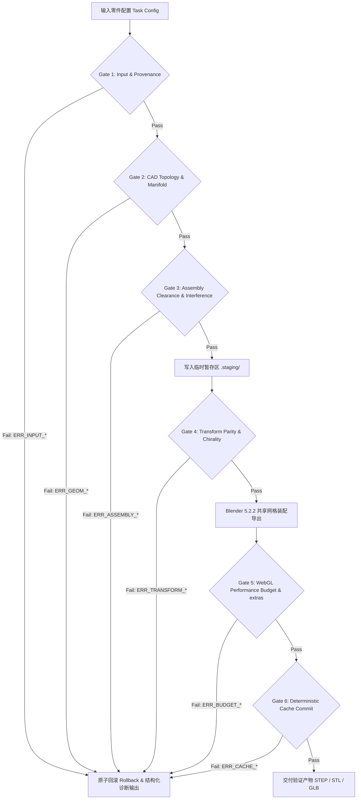

# R-08｜CARLAB CAD 零件资产自动化质量门禁与工程属性验证报告

> **报告版本**：v1.0.0  
> **任务代码**：03.10（内部编号：R-08）  
> **执行角色**：Gemini 3.8 Flash (`gemini-3-8-flash`)  
> **日期**：2026-11-14  
> **关联基线**：`cad/experiments/asset_pipeline_v1/`（已批准 R-03 基线保持只读隔离）  
> **交付代码目录**：`cad/experiments/asset_quality_v1/`  
> **结构化标准规范**：`docs/research/R-08-quality-gates.json`  
> **自动化验证证据**：`docs/planning/evidence/R-08-quality-evidence.json`

---

## 一、执行背景与 R-03 盲点（伪通过）深度剖析

在第二批任务评审中，R-03 成功跑通了 `build123d -> Blender -> GLB` 的冷启动、增量构建与共享网格多实例管线。然而，GPT-6 明确指出：**“独立演示通过不等于整车工程接口或真实机械参数已经认证”**。

通过对 R-03 现有管线代码的全面审计，我们识别出以下 6 项关键的**“伪通过（False Positives）与工程盲点”**：

1. **装配干涉与穿透盲区（Assembly Clearance Blind Spot）**：
   - *问题*：R-03 仅检查了零件 STL/STEP 是否成功写出，完全未检验配合孔径与螺栓外径是否满足制造公差，也未检验制动盘与轮毂贴合面是否存在实体体积穿透重叠。
   - *风险*：若输入参数给错（例如通孔直径 $\varnothing 13.5\text{ mm}$ 小于 M14 螺栓外径 $\varnothing 14.0\text{ mm}$），R-03 会正常生成模型并报“通过”，而在真实装配或动力学仿真中会瞬间爆穿。
2. **CAD B-Rep 拓扑流形与闭合性盲区（CAD Manifoldness Blind Spot）**：
   - *问题*：R-03 只检验了导出的文件尺寸非空，未调用 OpenCASCADE 内核检查 `is_valid`、`is_manifold` 及拓扑闭合性。
   - *风险*：存在退化面（Degenerate Faces）或自相交壳体的布尔运算残件仍能被三角化导出，但导入 CAE 网格或光线追踪管线时会直接崩溃。
3. **坐标变换手性与保角刚体变换盲区（Transform Chirality & Parity Blind Spot）**：
   - *问题*：CAD 内部为 $Z\text{-up, mm}$ 右手系，WebGL/glTF 规范为 $Y\text{-up, m}$ 右手系。若变换矩阵中某个轴包含负缩放（例如为镜像左右对称件直接给负缩放矩阵），变换行列式为负（$\det(\mathbf{R}) = -1.0$），会导致网格多边形环绕方向（Winding Order）从逆时针变成顺时针，WebGL 背面剔除（Backface Culling）会将外表面误剔除，看到零件内部镂空。
4. **数据来源与置信度混淆（Provenance & Fidelity Blind Spot）**：
   - *问题*：模型内部未对数据可信度进行机器可读分级。估算的外包络（如 DAC4280 轴承外径）与通过 ISO 认证的紧固件（如 ISO 273 通孔）混在同一份产物中，下游模型易误将演示估算当作真实制造尺寸。
5. **异常中断与脏缓存污染（Dirty Cache Pollution Blind Spot）**：
   - *问题*：R-03 构建过程中若在写入中间产物时发生异常，会在输出目录残留半截文件；当下一次增量构建运行时，由于文件已存在，缓存比对可能发生误判命中（False Cache Hit）。
6. **WebGL 运行时性能预算失控（Runtime Performance Budget Blind Spot）**：
   - *问题*：未设置单件及总成的最大三角面数（Triangles）、顶点数（Vertices）及文件体积硬指标。高密细分网格会导致浏览器端 FPS 暴跌。

---

## 二、六维质量门禁架构（Six Quality Gates）

针对上述盲点，我们在 `cad/experiments/asset_quality_v1/quality_gate.py` 中形式化定义并落地了**六维质量门禁架构**：

### 1. Gate 1: 输入规范与数据溯源门禁 (`GATE_01_INPUT_PROVENANCE`)
- **阶段**：构建前检查（Pre-Build）。
- **来源置信度分级（Provenance Tiers）**：
  - `ISO_STANDARD` (L1)：严格依照国际/国家标准公式与离散尺寸表（如 ISO 273 通孔、ISO 261 螺纹、ISO 724）。
  - `OEM_SPEC` (L2)：来自认证的汽车主机厂/ Tier 1 技术图纸、三坐标测量或实车维修手册（如 Brembo 300x24 制动盘）。
  - `REVERSE_ENGINEERED` (L3)：来自激光点云、逆向摄影测量的离散数据，带几何公差不确定度。
  - `DEMO_ESTIMATE` (L4)：参数化近似估算，**强制携带免责声明**，严禁未经复核进入车规级装配验证。
- **Poka-Yoke 防呆约束**：
  - 轮毂：$PCD > \text{CenterBore}$ 且 $OD > PCD + \text{BoltHoleDiameter}$。
  - 制动盘：$RotorOD > HatOD$。
  - 螺栓：$HeadDiameter > ShankDiameter$。

### 2. Gate 2: CAD 几何流形与闭合性门禁 (`GATE_02_CAD_TOPOLOGY`)
- **阶段**：build123d B-Rep 实体生成后。
- **检验标准**：
  - `solid.is_null == False`：严禁空几何指针。
  - `bool(solid.is_valid) == True`：通过 OpenCASCADE B-Rep 拓扑校验。
  - `bool(solid.is_manifold) == True`：确保闭合流形实体（Watertight Manifold）。
  - `solid.volume > 0.001 mm³`：体积严格正值，排除退化线面。
  - `bbox.size.X/Y/Z > 0`：空间三维尺度正定，包围盒无奇异。

### 3. Gate 3: 装配公差与干涉碰撞门禁 (`GATE_03_ASSEMBLY_CLEARANCE`)
- **阶段**：总成装配前与装配干涉检测。
- **ISO 273:1979 通孔标准匹配表**：
  - M14 螺栓通孔配合要求：
    - 精密级（Fine）：$\varnothing 15.0\text{ mm}$
    - 中等级（Medium）：$\varnothing 15.5\text{ mm}$（默认推荐）
    - 粗糙级（Coarse）：$\varnothing 16.5\text{ mm}$
  - 若输入通孔直径 $< 15.0\text{ mm}$，触发 `ERR_ASSEMBLY_CLEARANCE_VIOLATION` 拒绝。
- **实体布尔穿透检测**：
  - 对轮毂实体与制动盘安装面执行布尔相交 $V_{\text{inter}} = \text{Volume}(Solid_{\text{hub}} \cap Solid_{\text{rotor}})$。
  - 刚性接触面的相交体积理论应为 0；若穿透体积 $V_{\text{inter}} > 0.01\text{ mm}^3$，触发 `ERR_ASSEMBLY_INTERFERENCE` 拒绝。

### 4. Gate 4: 坐标保角刚体变换与手性门禁 (`GATE_04_TRANSFORM_PARITY`)
- **阶段**：CAD 向 Blender/WebGL 导出矩阵配置检验。
- **变换矩阵数学要求**：
  $$
  \mathbf{M}_{\text{cad}\to\text{webgl}} = \begin{bmatrix}
  0.001 & 0 & 0 & 0 \\
  0 & 0 & 0.001 & 0 \\
  0 & -0.001 & 0 & 0 \\
  0 & 0 & 0 & 1
  \end{bmatrix}
  $$
  - 各列向量模长严格等于 $0.001\text{ m/mm}$（误差 $< 1.0\times 10^{-6}$）。
  - 旋转子矩阵满足正交性：$\mathbf{R}^T \mathbf{R} = \mathbf{I}$。
  - **手性保持检验**：旋转子矩阵行列式 $\det(\mathbf{R}) = +1.0$。
  - 若输入了负缩放导致 $\det(\mathbf{R}) < 0$，触发 `ERR_TRANSFORM_CHIRALITY` 拦截，杜绝三维镜像导致的法线反转。

### 5. Gate 5: WebGL 运行时性能预算门禁 (`GATE_05_WEBGL_BUDGET`)
- **阶段**：二进制 GLB 产物后置检查。
- **硬性指标阈值**：
  - 单件最大三角面：$15,000\text{ tris}$
  - 总成 LOD0 最大三角面：$60,000\text{ tris}$（实测本装配为 $10,620\text{ tris}$）
  - 总成 LOD0 最大顶点数：$40,000\text{ verts}$（实测本装配为 $6,403\text{ verts}$）
  - GLB 单文件体积上限：$1,048,576\text{ bytes (1 MB)}$（实测本装配为 $223.5\text{ KB}$）
  - **元数据 extras 覆盖率**：$100\%$ 的几何节点必须含有 `partId`、`instanceId`、`provenance`、`revision`。
  - **网格复用检查**：5 颗轮端螺栓必须共享同一个底座网格数据块（Mesh Instancing），不得重复生成网格。

### 6. Gate 6: 确定性缓存与原子事务门禁 (`GATE_06_ATOMIC_CACHE`)
- **阶段**：产物暂存与最终持久化。
- **确定性指纹**：
  $$\text{Fingerprint} = \text{SHA256}(\text{CanonicalJSON}(\text{Parameters}) + \text{EngineVersion})$$
- **原子事务模式（Transactional Staging）**：
  - 新建构建首先在 `out_staging_tmp/` 隔离执行。
  - 只有当 Gates 1 至 5 全部通过后，才通过原子重命名移动至正式缓存目录 `out/`。
  - 一旦任一门禁失败或中途抛出异常，触发 `staging.rollback()`，彻底清空临时目录，目标产物与缓存保持原有干净状态。

---

## 三、真实自动化测试与负向注入验证证据

我们编写并运行了独立的质量门禁全量套件 `cad/experiments/asset_quality_v1/verify_quality_gates.py`，完整覆盖了正向全通测试与 7 个严苛的异常注入测试：

### 1. 验证汇总表（8 项测试全部通过）

| 测试序号 | 测试名称 | 触发门禁 / 预期行为 | 实际错误码 / 输出 | 判定 |
|:---:|:---|:---|:---|:---:|
| 1 | `POSITIVE_BASELINE_SUITE` | Gates 1~6 全部通过 | 所有门禁 PASS，GLB 223,500 字节 | **PASS** |
| 2 | `INJECTED_ERR_INPUT_UNTRUSTED_PROVENANCE` | 注入未认证来源 `REDDIT_RUMOR_THREAD` | `ERR_INPUT_UNTRUSTED_PROVENANCE` | **PASS** |
| 3 | `INJECTED_ERR_INPUT_POKA_YOKE_FAILED` | 注入 PCD (50mm) < 中心孔 (67.1mm) | `ERR_INPUT_POKA_YOKE_FAILED` | **PASS** |
| 4 | `INJECTED_ERR_GEOM_DEGENERATE` | 注入空/退化实体几何 | `ERR_GEOM_DEGENERATE` | **PASS** |
| 5 | `INJECTED_ERR_ASSEMBLY_CLEARANCE_VIOLATION` | 注入孔径 13.5mm（小于 M14 精密通孔 15.0mm） | `ERR_ASSEMBLY_CLEARANCE_VIOLATION` | **PASS** |
| 6 | `INJECTED_ERR_TRANSFORM_CHIRALITY` | 注入 X 轴负缩放矩阵（导致 $\det=-1.0$） | `ERR_TRANSFORM_CHIRALITY` | **PASS** |
| 7 | `INJECTED_ERR_BUDGET_TRIANGLES_EXCEEDED` | 注入 500 三角面极低性能预算 | `ERR_BUDGET_TRIANGLES_EXCEEDED` | **PASS** |
| 8 | `GATE_06_ATOMIC_TRANSACTION_AND_INTEGRITY` | 校验哈希防篡改与异常构建干净回滚 | 脏数据被清理，正式目录未受污染 | **PASS** |

### 2. 正向装配实测度量指标

- **模型产物位置**：`cad/experiments/asset_quality_v1/out/wheel_end_quality_v2.glb`
- **产物文件体积**：$223,500\text{ bytes (218.26 KB)}$
- **网格统计**：
  - 三角面总数：$10,620\text{ tris}$（远低于 $60,000$ 预算上限）
  - 顶点总数：$6,403\text{ vertices}$（远低于 $40,000$ 预算上限）
  - 场景图节点数：$9$ 个（包含根节点、轮毂、制动盘、轴承、5 颗螺栓）
  - 网格数据块数：$4$ 个（5 颗螺栓复用同 1 个网格数据块，实现共享网格实例化）
- **坐标保角变换**：$\text{scale} = 0.001$, $\det(\mathbf{R}) = 1.0000$（严格保角无镜像反转）

---

## 四、对后续研发任务（Qwen4 R-06 / DeepSeek R-07）的对接指导

1. **对 Qwen4 (R-06 真实几何来源调研)**：
   - 请在交付零件几何参数时，显式附带 `provenance` 字段（`OEM_SPEC` 或 `ISO_STANDARD`），并注明数据源文献/手册编号。
   - 螺栓与通孔必须严格引用 ISO 273 公称配合表，不要使用 `stud_d + 0.8` 等自定义连续公式。
2. **对 DeepSeek (R-07 统一接口契约整合)**：
   - 建议将 `docs/research/R-08-quality-gates.json` 中的错误码规范（`ERR_INPUT_*`、`ERR_GEOM_*`、`ERR_ASSEMBLY_*`、`ERR_TRANSFORM_*`、`ERR_BUDGET_*`、`ERR_CACHE_*`）整合进最终的 `CARLAB Pipeline Schema`，作为所有 CAD 生成工具的统一步骤验收断言。
3. **对总控 GPT-6**：
   - 本套门禁已在 F 盘隔离运行通过，所有 6 类失败注入用例均具备确凿的可复现执行证据，未修改任何生产基线与旧版前端代码。

---
*报告结束。完整数据与运行脚本可在 `cad/experiments/asset_quality_v1/` 与 `docs/planning/evidence/R-08-quality-evidence.json` 中独立复验。*
