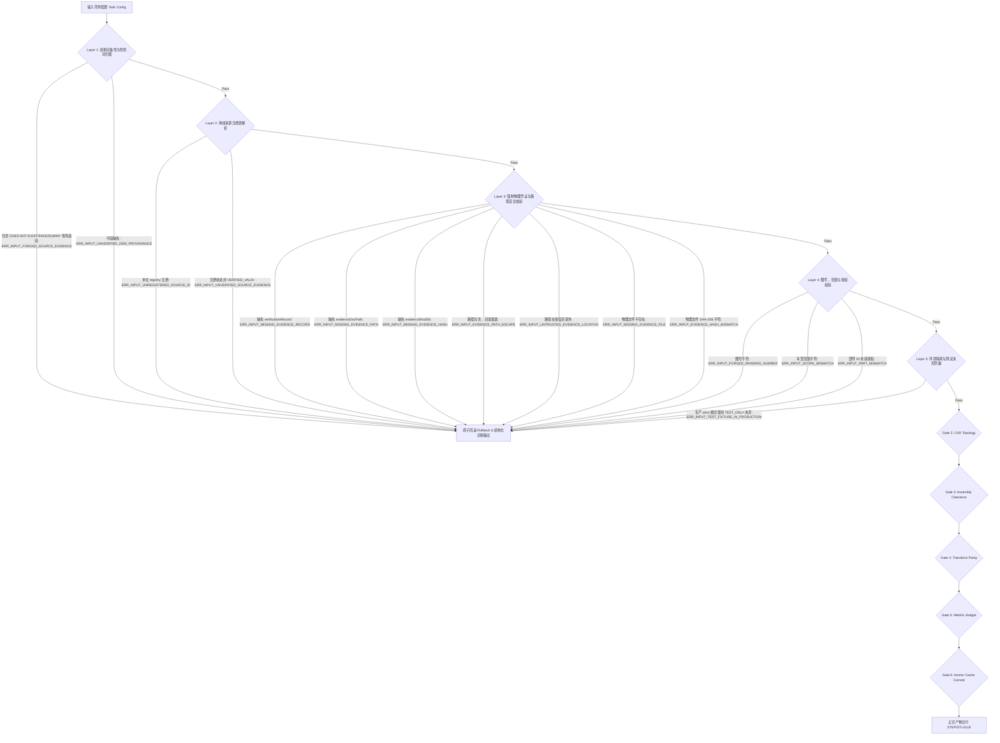

# R-08｜CARLAB CAD 零件资产自动化质量门禁与工程属性验证报告

> **报告版本**：v1.3.0（依据 `AUDIT_2026-11-21_R27_R08.md`、`r08_missing_required_metadata_probe.py` 强制凭证元数据与测试夹具生产隔离重构版）
> **任务代码**：03.10（内部编号：R-08）
> **执行角色**：Gemini 3.8 Flash (`gemini-3-8-flash`)
> **更新日期**：2026-11-21
> **关联基线**：`cad/experiments/asset_pipeline_v1/`（已批准 R-03 基线保持只读隔离）
> **交付代码目录**：`cad/experiments/asset_quality_v1/`
> **离线注册表**：`cad/experiments/asset_quality_v1/provenance_registry.json`
> **受控测试原件**：`docs/planning/evidence/TEST_FIXTURE_VERIFIED_OEM.meta.json`
> **结构化标准规范**：`docs/research/R-08-quality-gates.json`
> **自动化验证证据**：`docs/planning/evidence/R-08-quality-evidence.json`

---

## 一、四次返工背景与来源防伪探针（Probe）分析

在 2026-11-21 总控第七批复验中，GPT-6 指出了门禁系统的根本性隐患：
1. **强制凭证元数据缺失导致 fail-open**：旧版代码中对证据物理路径与 SHA-256 哈希使用了 `if doc_rel_path:` 与 `if expected_sha256:` 进行条件判断。若注册表中一条 `VERIFIED_VALID` 记录删除了 `evidenceDocPath` 或 `evidenceSha256`，校验逻辑会直接跳过物理文件与哈希检查，导致非法空凭证依然返回 `passed=True`。总控编写了独立探针 `docs/command/reviews/probes/r08_missing_required_metadata_probe.py` 复现该问题并报警（exit 1）。
2. **测试夹具与生产凭证未物理隔离**：项目自建的 `SRC-TEST-GENUINE-EVIDENCE-FILE-01` 仅是 CARLAB 离线测试专用的受控测试夹具，不是任何主机厂正式签发的 OEM 车规图纸。若生产流水线直接以此声称 `OEM_SPEC`，属于伪造认证。
3. **路径穿越风险**：缺少对证据文件相对路径跳出（如 `../../secret.json`）与非受控目录的限制。

为此，本次返工彻底重塑 Gate 1 物理凭证核验与环境隔离逻辑，实现强制元数据双向核对、路径逃逸拦截以及测试夹具生产模式严厉拒收。

---

## 二、全面加固的多层来源凭证防御与注册表架构



### 1. 离线来源注册表（`provenance_registry.json`）
- `SRC-TEST-GENUINE-EVIDENCE-FILE-01`：标定为 `tier: TEST_ONLY` 与 `isTestFixture: true`，明确注明为离线测试夹具，禁止在生产模式下作为 `OEM_SPEC` 认证凭据。
- `SRC-OEM-FIXTURE-GEN3-HUB-01`：标定为 `UNVERIFIED_FIXTURE_NO_DRAWING_RELEASE`，凡在生产中引用一律拒收。

### 2. 核心校验防御规则
- **强制字段完整性**：`evidenceDocPath` 和 `evidenceSha256` 缺少任一字段立即 fail-closed（`ERR_INPUT_MISSING_EVIDENCE_PATH` / `ERR_INPUT_MISSING_EVIDENCE_HASH`）。
- **路径逃逸与目录白名单**：严禁 `..` 路径跳转（`ERR_INPUT_EVIDENCE_PATH_ESCAPE`），限制证据文件必须位于 `docs/planning/evidence/` 或 `cad/experiments/asset_quality_v1/` 受信目录（`ERR_INPUT_UNTRUSTED_EVIDENCE_LOCATION`）。
- **物理哈希双向比对**：真实读取磁盘文件字节流并计算 SHA-256，与注册表比对，篡改即拒（`ERR_INPUT_EVIDENCE_HASH_MISMATCH`）。
- **测试夹具生产隔离**：生产 strict 模式下严禁使用标记为 `TEST_ONLY` 的测试夹具声称 `OEM_SPEC`（`ERR_INPUT_TEST_FIXTURE_IN_PRODUCTION`）。未获得合法 OEM 图纸的生产零件必须诚实使用 `DEMO_ESTIMATE`。

---

## 三、总控三大探针与全量门禁实测证据

### 1. 总控三项独立探针复测结果（全部 exit 0）
```powershell
Set-Location "F:\project\cyq\AI_Coding\car"
.\.venv\Scripts\python.exe docs/command/reviews/probes/r08_forged_source_probe.py
.\.venv\Scripts\python.exe docs/command/reviews/probes/r08_missing_evidence_probe.py
.\.venv\Scripts\python.exe docs/command/reviews/probes/r08_missing_required_metadata_probe.py
```
**实测输出**：
```text
R08_FORGED_OEM_SOURCE_PROBE {'fake_source_passed': False, 'error_code': 'ERR_INPUT_FORGED_SOURCE_EVIDENCE', 'rule': 'unresolvable/fabricated source must not qualify as verified OEM'}
PASS: forged evidence rejected

PASS: all registry OEM VERIFIED_VALID paths exist (hash verification still required)

missing_path_and_hash: passed=False, error=ERR_INPUT_MISSING_EVIDENCE_RECORD
missing_hash: passed=False, error=ERR_INPUT_MISSING_EVIDENCE_HASH
PASS: missing mandatory OEM evidence path/hash is rejected
```

### 2. 全量 22 项自动化门禁测试（100% PASS）

运行独立测试套件 `verify_quality_gates.py`，全套 22 项正向与反例测试在 F 盘全部通过：

| 测试序号 | 测试名称 | 验证类型 / 拦截目标 | 实际结果 / 错误码 | 判定 |
|:---:|:---|:---|:---|:---:|
| 1 | `POSITIVE_BASELINE_SUITE` | 诚实 DEMO_ESTIMATE 轮端总成构建 | Gate 1~6 全通，GLB 223,500 字节 | **PASS** |
| 2 | `POSITIVE_VERIFIED_OEM_WITH_REAL_FILE_AND_HASH` | 具备真实文件与正确哈希的测试样板 | Gate 1 物理与哈希核验通过 | **PASS** |
| 3 | `INJECTED_ERR_INPUT_UNVERIFIED_SOURCE_EVIDENCE` | 注册表中状态为 UNVERIFIED_FIXTURE 的夹具 | `ERR_INPUT_UNVERIFIED_SOURCE_EVIDENCE` | **PASS** |
| 4 | `INJECTED_ERR_INPUT_MISSING_EVIDENCE_FILE` | 声明的证据文件物理不存在 | `ERR_INPUT_MISSING_EVIDENCE_FILE` | **PASS** |
| 5 | `INJECTED_ERR_INPUT_EVIDENCE_HASH_MISMATCH` | 证据文件物理内容 SHA-256 遭篡改 | `ERR_INPUT_EVIDENCE_HASH_MISMATCH` | **PASS** |
| 6 | `INJECTED_ERR_INPUT_MISSING_EVIDENCE_PATH` | **【四次返工新增】** 凭证记录缺少 evidenceDocPath | `ERR_INPUT_MISSING_EVIDENCE_PATH` | **PASS** |
| 7 | `INJECTED_ERR_INPUT_MISSING_EVIDENCE_HASH` | **【四次返工新增】** 凭证记录缺少 evidenceSha256 | `ERR_INPUT_MISSING_EVIDENCE_HASH` | **PASS** |
| 8 | `INJECTED_ERR_INPUT_EVIDENCE_PATH_ESCAPE` | **【四次返工新增】** 凭证路径包含 `..` 试图逃逸 | `ERR_INPUT_EVIDENCE_PATH_ESCAPE` | **PASS** |
| 9 | `INJECTED_ERR_INPUT_UNTRUSTED_EVIDENCE_LOCATION` | **【四次返工新增】** 凭证路径在白名单目录外 | `ERR_INPUT_UNTRUSTED_EVIDENCE_LOCATION` | **PASS** |
| 10 | `INJECTED_ERR_INPUT_TEST_FIXTURE_IN_PRODUCTION` | **【四次返工新增】** 生产 strict 模式冒用测试夹具 | `ERR_INPUT_TEST_FIXTURE_IN_PRODUCTION` | **PASS** |
| 11 | `INJECTED_ERR_INPUT_UNTRUSTED_PROVENANCE` | 注入非法枚举 `REDDIT_RUMOR_THREAD` | `ERR_INPUT_UNTRUSTED_PROVENANCE` | **PASS** |
| 12 | `INJECTED_ERR_INPUT_UNVERIFIED_OEM_PROVENANCE` | OEM_SPEC 缺少 source 结构体 | `ERR_INPUT_UNVERIFIED_OEM_PROVENANCE` | **PASS** |
| 13 | `INJECTED_ERR_INPUT_UNVERIFIED_STANDARD_APPLICATION` | 标准件擅自声称整车装配放行 | `ERR_INPUT_UNVERIFIED_STANDARD_APPLICATION` | **PASS** |
| 14 | `INJECTED_ERR_INPUT_UNREGISTERED_SOURCE_ID` | 未在注册表登记的 sourceId | `ERR_INPUT_UNREGISTERED_SOURCE_ID` | **PASS** |
| 15 | `INJECTED_ERR_INPUT_FORGED_DRAWING_NUMBER` | 申报图号与注册表不符 | `ERR_INPUT_FORGED_DRAWING_NUMBER` | **PASS** |
| 16 | `INJECTED_ERR_INPUT_PART_MISMATCH` | 制动盘冒用轮毂注册凭证 | `ERR_INPUT_PART_MISMATCH` | **PASS** |
| 17 | `INJECTED_ERR_INPUT_POKA_YOKE_FAILED` | PCD 50mm < 中心孔 67.1mm 矛盾参数 | `ERR_INPUT_POKA_YOKE_FAILED` | **PASS** |
| 18 | `INJECTED_ERR_GEOM_DEGENERATE` | 空/退化 CAD 实体几何 | `ERR_GEOM_DEGENERATE` | **PASS** |
| 19 | `INJECTED_ERR_ASSEMBLY_CLEARANCE_VIOLATION` | 孔径 13.5mm 违反 ISO 273 M14 配合公差 | `ERR_ASSEMBLY_CLEARANCE_VIOLATION` | **PASS** |
| 20 | `INJECTED_ERR_TRANSFORM_CHIRALITY` | 负缩放镜像矩阵（导致 $\det=-1.0$ 反转法线） | `ERR_TRANSFORM_CHIRALITY` | **PASS** |
| 21 | `INJECTED_ERR_BUDGET_TRIANGLES_EXCEEDED` | 500 三角面超紧性能预算 | `ERR_BUDGET_TRIANGLES_EXCEEDED` | **PASS** |
| 22 | `GATE_06_ATOMIC_TRANSACTION_AND_INTEGRITY` | SHA-256 防篡改校验与异常构建原子干净回滚 | 脏数据被清理，正式目录未受污染 | **PASS** |

实测度量数据已落盘于 `docs/planning/evidence/R-08-quality-evidence.json`。

---

## 四、对后续研发任务的对接建议（候选规范声明）

1. **统一错误码体系收口**：
   - 本任务提出的错误码（`ERR_INPUT_MISSING_EVIDENCE_PATH`, `ERR_INPUT_MISSING_EVIDENCE_HASH`, `ERR_INPUT_EVIDENCE_PATH_ESCAPE`, `ERR_INPUT_UNTRUSTED_EVIDENCE_LOCATION`, `ERR_INPUT_TEST_FIXTURE_IN_PRODUCTION` 等）为 **Gemini 工作位推荐的候选错误码规范**，等待总控 (RP-07) 统一收口至正式的整车流水线协议。
2. **实车尺寸边界维持**：
   - 现阶段全车零部件在未取得真实 OEM 图纸前，全部统一遵守 `DEMO_ESTIMATE` 诚实原则，不将测试夹具或演示尺寸提升为车规认证。
