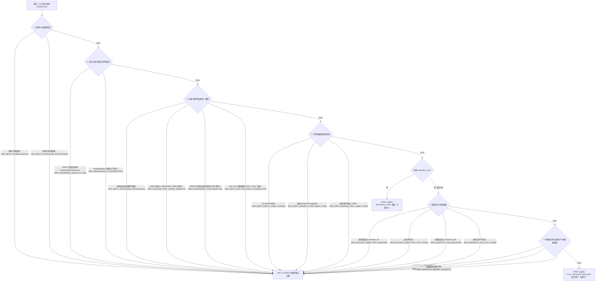

# R-34｜左前轮端 CAD 发布包来源门禁验证与语义映射报告 (v1.2.0 返工加固版)

> **任务标识**：R-34（内部文件编号：03.36）  
> **执行模型**：Gemini 3.8 Flash (`gemini-3-8-flash`)  
> **验证目标**：将 R-08 质量门禁与防伪纪律应用于 Codex CAD 已验收的 C-01 发布包（`c01-c5d74da77c293aa5321f`），验证其作为演示资产的完整性与边界，修复总控在 `AUDIT_2026-11-22_ALL_SUBMISSIONS.md` 指出的三项不完整输入漏洞，提供清晰区分的完整发布包校验模式与只读元数据检查模式，并向整车工作台及下游模型交付来源词汇映射规范。  
> **交付代码目录**：`cad/experiments/wheel-end-provenance-v1/`  
> **结构化实测证据**：`docs/planning/evidence/R-34-provenance-evidence.json`  
> **词汇映射规约**：`cad/experiments/wheel-end-provenance-v1/vocabulary_map.json`  

---

## 一、执行背景与任务目标

在第七批总控审核与左前轮端交接复核中，Codex CAD 交付了首个可复建、通过无干涉装配检查的左前轮端 CAD 资产包 `c01-c5d74da77c293aa5321f`。该包定义了 5 份独立 STEP、9 个规范零件实例（转向节、轴承内外圈、轮毂、5 颗螺柱）及 GLB 渲染网格。

针对总控在 `AUDIT_2026-11-22_ALL_SUBMISSIONS.md` 中指出的三项不完整输入放行漏洞（删除零件 STEP 摘要仍过、省略快照文件仍过、省略发布目录仍过），Gemini 实施了 v1.2.0 深度加固：
1. **真实发布包全资产强覆盖（Full Asset Hash Coverage）**：
   - 清单中声明的装配 STEP（`assets.step`）、GLB（`assets.glb`）以及每个独立零件（`partDefinitions[partId].step`）必须 100% 在 `sha256` 摘要字典中登记且非空；
   - 删除任何零件（如 `PART-20-016`）的 STEP 摘要立即返回清晰错误 `ERR_INPUT_MISSING_PART_ASSET_HASH`，彻底杜绝局部漏审。
2. **真实包入口强制路径完备性**：
   - 真实包校验模式强制要求传入 `package_dir` 与 `snapshot_file`；
   - 省略发布目录立即拦截并返回 `ERR_PACKAGE_DIRECTORY_REQUIRED`；
   - 省略快照文件立即拦截并返回 `ERR_SNAPSHOT_FILE_REQUIRED`；
   - 物理路径不存在立即拦截（`ERR_PACKAGE_DIRECTORY_NOT_FOUND` / `ERR_SNAPSHOT_FILE_NOT_FOUND`）。
3. **显式只读元数据模式与真实发布模式双轨隔离**：
   - 提供显式的 `metadata_only=True` 选项；
   - 元数据检查模式下仅校验清单格式、词汇等级、零件矛盾与清单声明完整性，不依赖磁盘实体；
   - 结果中显式标明 `verificationMode: "METADATA_ONLY"`，且 `verifiedFilesCount: 0`，与完整发布包的 `FULL_PACKAGE_RELEASE`（7 文件核验证实）产生机器可辨识的明确区别。
4. **全套自动化测试扩展至 15 项**：
   - 覆盖 2 项正向用例（完整包发布验收 + 元数据只读验收）与 13 项异常注入负例（全覆盖缺失、篡改、矛盾与不完整输入）。

---

## 二、跨模型来源词汇语义映射表（Vocabulary Mapping）

为解决各工作流术语差异，我们在 `cad/experiments/wheel-end-provenance-v1/vocabulary_map.json` 中定义了标准映射字典：

| 来源标签 / 状态 | 出现语境 / 来源 | R-08 对应层级 | 数学/几何完整性 | 整车工程认证状态 | 下游消费准则（DeepSeek R-32 / Grok R-33 / Composer R-29） |
|:---|:---|:---:|:---:|:---:|:---|
| **`DEMO_ASSUMPTION`** | C-01 清单包级、参数级、材料级与安装孔级 | `DEMO_ESTIMATE` (L4) | **已证实**（封闭实体流形、装配 0 穿透） | **未认证**（基于工程假设，无实车图纸） | 工作台视窗贴 `[DEMO_ASSUMPTION]` 徽标；禁止用于整车公差认证或碰撞安全结论。 |
| **`DEMO_ESTIMATE`** | R-08 资产质量门禁标准 | `DEMO_ESTIMATE` (L4) | **已证实**（通过 Gate 2 退化检测） | **未认证**（附带必须的 demo 声明） | 与 `DEMO_ASSUMPTION` 等价映射，属于非生产级演示样例。 |
| **`DEMO_SUBSTITUTE`** | C-01 `snapshotBinding.mappingStatus` | 演示实例映射 | **已证实**（具备 9 个独立节点网格） | **未证实**（`sameVehicleClaim: false`） | DeepSeek R-32 可将网格绑定到快照 9 实例；不得提升为已证实同车实车零件。 |
| **`NO_GEOMETRY`** | 整车快照基线（278 个零件实例） | 无资产基线 | **无**（纯工程数据节点） | **未建模** | 工作台显示为无几何节点或线框占位，严禁凭空捏造实体网格。 |
| **`COUNTERPART_NOT_MODELED`** | C-01 `externalMounts`（上下球头锥孔） | 未建模配合面 | **局部几何存在**（具备安装基准点） | **未装配闭合** | 装配求解器标记为未闭合；Grok R-33 运动学解算阻断整车动态闭环。 |
| **`OEM_SPEC`** | 车规级生产放行标准 | `OEM_SPEC` (L2) | **需图纸证实** | **强制强校验** | 必须在离线注册表登记、原件在磁盘存在、SHA-256 吻合且非测试夹具。 |

---

## 三、C-01 轮端包来源校验器架构（WheelEndProvenanceChecker v1.2.0）

我们在 `cad/experiments/wheel-end-provenance-v1/wheel_end_provenance_checker.py` 中实现了专用的校验引擎：



---

## 四、全量测试套件与实测证据 (15/15 100% 通过)

我们在 `cad/experiments/wheel-end-provenance-v1/verify_wheel_end_provenance.py` 中执行了 2 项正向测试与 13 项异常注入负例测试，**15 项测试全部 100% 通过（退出码 0）**：

```powershell
Set-Location "F:\project\cyq\AI_Coding\car"
.\.venv\Scripts\python.exe cad/experiments/wheel-end-provenance-v1/verify_wheel_end_provenance.py
```

### 1. 实测结果汇总表

| 序号 | 测试用例名称 | 验证类型 / 注入异常 | 预期错误码 | 实际结果 | 状态 |
|:---:|:---|:---|:---:|:---:|:---:|
| 1 | `POSITIVE_C01_AUTHENTIC_PACKAGE` | **真实包发布正向基线**：C-01 真实发布包全部 7 文件与快照实测核验 | `None` (PASS) | `passed=True`, `FULL_PACKAGE_RELEASE`, 7 文件全验证 | **PASS** |
| 2 | `POSITIVE_METADATA_ONLY_MODE` | **只读元数据正向基线**：显式只读模式核验，不依赖磁盘实体 | `None` (PASS) | `passed=True`, `METADATA_ONLY`, 计数为 0，明晰区分 | **PASS** |
| 3 | `INJECTED_ERR_MISSING_PACKAGE_SOURCE_GRADE` | **负例 1**：删除清单根级 `sourceGrade` 声明 | `ERR_INPUT_SCHEMA_INVALID` | 精准拦截，退出码非零判定通过 | **PASS** |
| 4 | `INJECTED_ERR_PROVENANCE_CONTRADICTION` | **负例 2**：DEMO 包混入未经注册的 OEM_SPEC 轮毂 | `ERR_PROVENANCE_CONTRADICTION` | 精准拦截包与零件来源矛盾 | **PASS** |
| 5 | `INJECTED_ERR_PACKAGE_PART_GRADE_MISMATCH` | **负例 3**：包级擅自升级为 OEM_SPEC 但零件仍为 DEMO | `ERR_PACKAGE_PART_GRADE_MISMATCH` | 精准拦截虚构整包车规升级 | **PASS** |
| 6 | `INJECTED_ERR_TEST_FIXTURE_IN_PRODUCTION` | **负例 4**：生产模式使用 `TEST_ONLY` 夹具冒充车规凭证 | `ERR_INPUT_TEST_FIXTURE_IN_PRODUCTION` | 精准拦截测试夹具生产污染 | **PASS** |
| 7 | `INJECTED_ERR_UNVERIFIED_VEHICLE_CLAIM` | **负例 5**：DEMO 包擅自声称 `sameVehicleClaim: true` | `ERR_UNVERIFIED_VEHICLE_CLAIM` | 精准拦截虚假同车放行声明 | **PASS** |
| 8 | `INJECTED_ERR_ASSET_HASH_MISMATCH` | **负例 6**：篡改 `wheel-end.glb` 清单哈希值 | `ERR_ASSET_HASH_MISMATCH` | 精准拦截资产物理文件篡改 | **PASS** |
| 9 | `INJECTED_ERR_SNAPSHOT_BINDING_MISMATCH` | **负例 7**：篡改 `snapshotBinding.snapshotSha256` | `ERR_SNAPSHOT_BINDING_MISMATCH` | 精准拦截跨模型快照绑定篡改 | **PASS** |
| 10 | `INJECTED_ERR_PACKAGE_OEM_WITH_UNKNOWN_PARTS` | **负例 8**：包级声明 OEM_SPEC，零件标注 UNKNOWN | `ERR_PACKAGE_PART_GRADE_MISMATCH` | 彻底杜绝未知来源混入 OEM 放行 | **PASS** |
| 11 | `INJECTED_ERR_EMPTY_SHA256_MANIFEST` | **负例 9**：清单中 `sha256` 传入空字典 `{}` | `ERR_INPUT_EMPTY_ASSET_HASHES` | 彻底杜绝空摘要绕过校验 | **PASS** |
| 12 | `INJECTED_ERR_NONEXISTENT_PACKAGE_DIRECTORY` | **负例 10**：传入不存在的发布目录路径 | `ERR_PACKAGE_DIRECTORY_NOT_FOUND` | 严格校验物理目录存在性 | **PASS** |
| 13 | `INJECTED_ERR_MISSING_PART_ASSET_HASH` | **负例 11 (新增)**：删除 `PART-20-016` 的 STEP 摘要 | `ERR_INPUT_MISSING_PART_ASSET_HASH` | 强制零件 STEP 全覆盖，杜绝漏审 | **PASS** |
| 14 | `INJECTED_ERR_OMITTED_SNAPSHOT_FILE` | **负例 12 (新增)**：真实包校验省略快照文件路径 | `ERR_SNAPSHOT_FILE_REQUIRED` | 真实包强制要求实际快照绑定 | **PASS** |
| 15 | `INJECTED_ERR_OMITTED_PACKAGE_DIRECTORY` | **负例 13 (新增)**：真实包校验省略发布目录路径 | `ERR_PACKAGE_DIRECTORY_REQUIRED` | 真实包强制要求发布目录 | **PASS** |

实测度量数据落盘于：[R-34-provenance-evidence.json](file:///F:/project/cyq/AI_Coding/car/docs/planning/evidence/R-34-provenance-evidence.json)。

---

## 五、下游消费者操作规约（对 DeepSeek R-32、Grok R-33、Composer R-29）

1. **对 DeepSeek (R-32 实例绑定)**：
   - 确认 C-01 的 9 个物理网格可绑定至快照对应的 9 个 `PI-*`（如 `PI-30-006-FL`、`PI-20-016-FL`、`PI-30-009-FL-01~05`）；
   - 绑定状态应标为 `DEMO_SUBSTITUTE`，且必须保持 `sameVehicleClaim: false`；
   - 严禁将 `DEMO_SUBSTITUTE` 属性隐式升级为整车认证装配。
2. **对 Grok (R-33 运动配准)**：
   - C-01 清单中 `partDefinitions.PART-20-016.mounts` 下的 `bearingSeatFront`、`upperBallJointSeat`、`lowerBallJointSeat` 属于 `DEMO_ASSUMPTION` 局部工装坐标；
   - 锥孔到球心在实物基准未对齐时，必须保持 `COUNTERPART_NOT_MODELED` 与运动解算阻断，不可虚构外拉杆球销。
3. **对 Composer (R-29 3D 工作台展示)**：
   - 左栏整车树与 3D 检查面板中，C-01 节点统一渲染视觉标签 `[DEMO_ASSUMPTION]`；
   - 不得在视窗中渲染未通过实测的虚构同源几何。
4. **对 R-36 静态接入**：
   - 消费已验收且固定版本的 C-01 演示包；
   - 当前 R-34 检查器作为发布门禁与 CI 保障脚本独立运行，暂不直接接入 Web UI 页面。
   - 针对未建模的 269 个整车零件，保持 `[NO_GEOMETRY]` 线框/占位标识，形成鲜明对照。

---

## 六、诚实记录与边界结论

1. **C-01 包是合规且高质量的 DEMO 资产**：其 7 份实体模型具备严谨的数学几何与公差自洽性，但**并非主机厂实车制造图纸**；
2. **免责与未知声明保持完整**：当前 CARLAB 项目无真实主机厂 OEM 图纸，全车 278 个零件实例继续保持对齐 Qwen4 R-06 的关键未知标记，无图纸不制造虚假车规认证。
