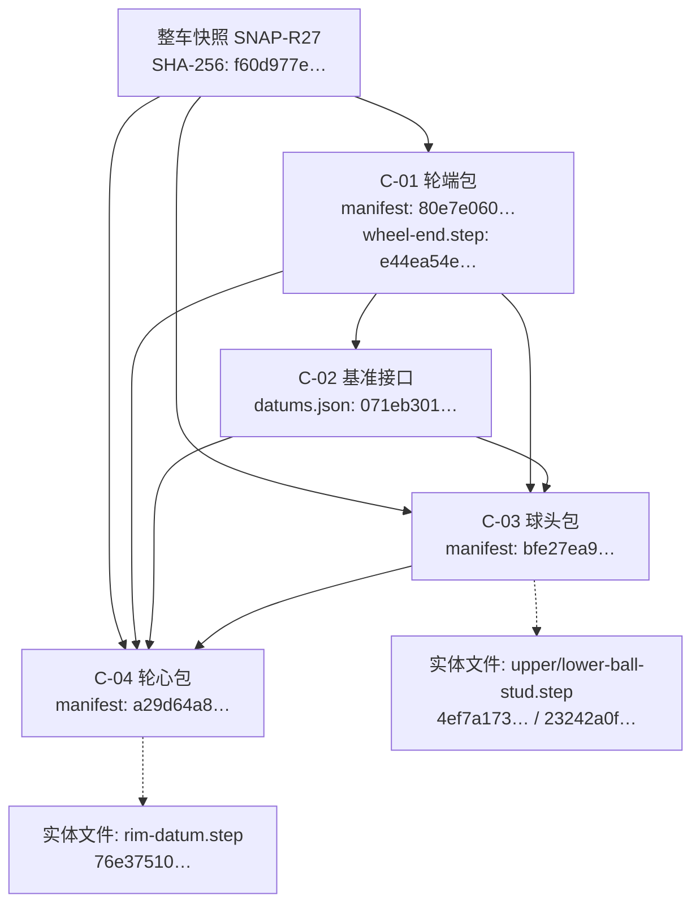

# R-43｜C-03 与 C-04 发布包来源依赖与血缘完整性验证报告

> **任务标识**：R-43（内部文件编号：03.45）  
> **执行模型**：Gemini 3.8 Flash (`gemini-3-8-flash`)  
> **验证目标**：复用 R-34 发布核验思想，对 Codex CAD 已验收的 C-03 演示球头发布包（`c03-3f4bf8c599df28679b86`）与 C-04 演示轮心发布包（`c04-bae128570c76aec59353`）开展独立来源与血缘依赖审计。核查实体文件、真实整车快照绑定、跨包（C-01、C-02、C-03）哈希链条完备性，坚决捍卫 `DEMO_ASSUMPTION`、候选几何身份与运动播放关闭边界。  
> **交付代码目录**：`cad/experiments/wheel-end-release-lineage-v1/`  
> **结构化实测证据**：`docs/planning/evidence/R-43-lineage-evidence.json`  

---

## 一、执行背景与任务目标

在 CARLAB 轮端同源演示基准推进中，Codex CAD 先后完成了：
- **C-03 球头包**：包含上、下两根简化球头销 STEP（`upper-ball-stud.step`、`lower-ball-stud.step`），作为控制臂与转向节的装配试凑输入，并给出工装根基底下可复算的演示球心；
- **C-04 轮心包**：包含 `rim-datum.step` 轮辋基准实体，定义了基于 C-01 轮毂安装面与 C-02 基准轴向的轮心中面及标称偏距（+24.0 mm）。

依总控在 `AUDIT_2026-11-22_C04_R34_R37_R39.md` 与 `docs/tasks/R-43-c03-c04-release-provenance.md` 中的统一部署，Gemini 负责对两包实施严格的发布门禁与跨包血缘依赖审计：
1. **真实发布实体核验**：对 C-03 两份球头 STEP 和 C-04 轮辋 STEP 进行 100% 字节哈希重算核验，校验真实磁盘文件存在性与大小；
2. **跨包依赖拓扑锁死（Lineage Interlocking）**：对 C-03 引用的 C-01 清单及装配 STEP、C-02 基准、以及 C-04 引用的 C-01、C-02、C-03 清单及球头 STEP 摘要进行交叉互验，确保整个演示资产链条具备强密码学防伪一致性；
3. **真实发布与只读元数据双轨模式**：提供清晰区分的完整发布包校验模式（强制目录与快照文件）与只读元数据检查模式（文件数计为 0，显式标识 `METADATA_ONLY`）；
4. **演示边界与运动阻断防线**：坚决防范虚构生产升级，强制 `playbackAllowed: false`，拦截虚假同车声明 `sameVehicleClaim: true`，确保下游安全消费。

---

## 二、同源资产密码学血缘链条（Lineage Topology）



### 跨包依赖哈希交叉核对矩阵

| 上游被依赖资产 | 真实磁盘文件路径 | 实测 SHA-256 摘要 | C-03 引用一致性 | C-04 引用一致性 |
|:---|:---|:---:|:---:|:---:|
| **整车快照** | `src-experiments/vehicle-snapshot-v1/fixtures/vehicle-snapshot.json` | `f60d977efc2f5aefb878610b6b5a0bedb7579146f41a6a65528470e8b6a507c4` | **100% 吻合** | **100% 吻合** |
| **C-01 清单** | `cad/experiments/vehicle-cad-pipeline-v1/out/c01-c5d74da77c293aa5321f/manifest.json` | `80e7e060de6b20015a6fdb8d5b81ea60b9e23ac442cebbb96b2bc2a5b5222d6a` | **100% 吻合** | **100% 吻合** |
| **C-01 装配 STEP** | `cad/experiments/vehicle-cad-pipeline-v1/out/c01-c5d74da77c293aa5321f/wheel-end.step` | `e44ea54eded24673c1578e321eb8fe4438688c21913e1b41f9eedc34ef8cdf7d` | **100% 吻合** | **100% 吻合** |
| **C-02 基准接口** | `cad/experiments/wheel-end-datum-interface-v1/datums.json` | `071eb3019dceeec74a53dc446f99413fadeaffc0a796358f61bb515a86e5f146` | **100% 吻合** | **100% 吻合** |
| **C-03 清单** | `cad/experiments/wheel-end-ball-joint-demo-v1/out/c03-3f4bf8c599df28679b86/manifest.json` | `bfe27ea9f2ae6a3283a463389950373c5338287f6200b1179a6ed46b7d337e91` | *（自发布源）* | **100% 吻合** |
| **C-03 上球头 STEP** | `.../c03-3f4bf8c599df28679b86/upper-ball-stud.step` | `4ef7a17304c035edbceb8bb76009fd389e2f483d8488b4d67bb84056ed9fb88b` | **100% 吻合** | **100% 吻合** |
| **C-03 下球头 STEP** | `.../c03-3f4bf8c599df28679b86/lower-ball-stud.step` | `23242a0fb1c9a93081f64bc5faeff815e8648ac2b2322b91491f5c54663918dd` | **100% 吻合** | **100% 吻合** |
| **C-04 轮辋 STEP** | `.../c04-bae128570c76aec59353/rim-datum.step` | `76e37510b2b99694c9024f5a0e65e89d71ba0da2266a71ba1b3c9b633fc8810f` | *（下游包）* | **100% 吻合** |

---

## 三、校验器架构与双轨运行机制（WheelEndLineageChecker）

我们在 `cad/experiments/wheel-end-release-lineage-v1/wheel_end_lineage_checker.py` 中实现了专用的血缘校验引擎：

```mermaid
flowchart TD
    In[输入发布清单 manifest.json] --> S1{1. Schema 架构识别}
    S1 -- c03DemoBallStuds/1 --> C03Branch[进入 C-03 球头包校验流程]
    S1 -- c04DemoWheelCenter/1 --> C04Branch[进入 C-04 轮心包校验流程]
    S1 -- 未知版本 --> ErrSchema[拦截: ERR_INPUT_SCHEMA_INVALID]
    
    C03Branch --> S2{2. 来源与边界强校验}
    C04Branch --> S2
    S2 -- 试图升级为 OEM_SPEC: ERR_UNVERIFIED_SOURCE_UPGRADE --> Fail[FAIL-CLOSED 拦截]
    S2 -- 试图开启播放 playbackAllowed=true: ERR_ILLEGAL_PLAYBACK_ENABLED --> Fail
    S2 -- 虚构同车声明 sameVehicleClaim=true: ERR_UNVERIFIED_VEHICLE_CLAIM --> Fail
    
    S2 -- Pass --> S3{3. 跨包依赖哈希校验}
    S3 -- C-01/C-02/C-03 清单或 STEP 哈希与磁盘不符: ERR_DEPENDENCY_HASH_MISMATCH --> Fail
    
    S3 -- Pass --> S4{4. 清单自身 sha256 完整性}
    S4 -- 空哈希字典: ERR_INPUT_EMPTY_ASSET_HASHES --> Fail
    S4 -- 缺失 upper/lower/rim STEP 摘要: ERR_INPUT_MISSING_ASSET_HASH --> Fail
    
    S4 -- Pass --> ModeChoice{运行模式判断}
    ModeChoice -- metadata_only=True --> MetaPass[PASS: METADATA_ONLY 模式<br/>核验文件数计为 0]
    ModeChoice -- metadata_only=False (完整发布) --> S5{5. 物理路径与实体存在性校验}
    S5 -- 缺目录: ERR_PACKAGE_DIRECTORY_REQUIRED --> Fail
    S5 -- 目录不存在: ERR_PACKAGE_DIRECTORY_NOT_FOUND --> Fail
    S5 -- 缺快照: ERR_SNAPSHOT_FILE_REQUIRED --> Fail
    S5 -- 快照不存在: ERR_SNAPSHOT_FILE_NOT_FOUND --> Fail
    S5 -- 快照哈希不符: ERR_SNAPSHOT_BINDING_MISMATCH --> Fail
    S5 -- STEP 磁盘实体缺失: ERR_ASSET_FILE_MISSING --> Fail
    S5 -- STEP 实际哈希不符: ERR_ASSET_HASH_MISMATCH --> Fail
    S5 -- Pass --> FullPass[PASS: FULL_PACKAGE_RELEASE 模式<br/>实测核验 2 件 (C-03) 或 1 件 (C-04)]
```

---

## 四、全量自动化测试套件与实测证据 (22/22 100% 通过)

我们在 `cad/experiments/wheel-end-release-lineage-v1/verify_release_lineage.py` 中执行了 4 项正向基线测试与 18 项异常注入负例测试，**22 项测试全部 100% 通过（退出码 0）**：

```powershell
Set-Location "F:\project\cyq\AI_Coding\car"
.\.venv\Scripts\python.exe cad/experiments/wheel-end-release-lineage-v1/verify_release_lineage.py
```

### 1. 实测结果汇总表

| 序号 | 测试用例名称 | 测试目标 / 注入异常 | 预期错误码 | 实际结果 | 状态 |
|:---:|:---|:---|:---:|:---:|:---:|
| 1 | `POSITIVE_C03_AUTHENTIC_FULL_RELEASE` | **正向**：C-03 真实发布包完整验证（2 STEP + 快照 + C-01/C-02 依赖） | `None` (PASS) | `passed=True`, `FULL_PACKAGE_RELEASE`, 2 文件通过 | **PASS** |
| 2 | `POSITIVE_C03_METADATA_ONLY` | **正向**：C-03 显式只读元数据模式验证 | `None` (PASS) | `passed=True`, `METADATA_ONLY`, 计数 0 | **PASS** |
| 3 | `POSITIVE_C04_AUTHENTIC_FULL_RELEASE` | **正向**：C-04 真实发布包完整验证（1 STEP + 快照 + C-01/C-02/C-03 依赖） | `None` (PASS) | `passed=True`, `FULL_PACKAGE_RELEASE`, 1 文件通过 | **PASS** |
| 4 | `POSITIVE_C04_METADATA_ONLY` | **正向**：C-04 显式只读元数据模式验证 | `None` (PASS) | `passed=True`, `METADATA_ONLY`, 计数 0 | **PASS** |
| 5 | `INJECTED_C03_MISSING_STEP_HASH` | **负例 1**：删除 C-03 清单中 `upper-ball-stud.step` 的 SHA-256 摘要 | `ERR_INPUT_MISSING_ASSET_HASH` | 精准拦截缺球头 STEP 摘要 | **PASS** |
| 6 | `INJECTED_C04_MISSING_STEP_HASH` | **负例 2**：删除 C-04 清单中 `rim-datum.step` 的 SHA-256 摘要 | `ERR_INPUT_MISSING_ASSET_HASH` | 精准拦截缺轮心 STEP 摘要 | **PASS** |
| 7 | `INJECTED_C03_EMPTY_SHA256` | **负例 3**：C-03 清单传入空摘要字典 `sha256: {}` | `ERR_INPUT_EMPTY_ASSET_HASHES` | 精准拦截空哈希字典 | **PASS** |
| 8 | `INJECTED_C04_EMPTY_SHA256` | **负例 4**：C-04 清单传入空摘要字典 `sha256: {}` | `ERR_INPUT_EMPTY_ASSET_HASHES` | 精准拦截空哈希字典 | **PASS** |
| 9 | `INJECTED_C03_TAMPERED_STEP_HASH` | **负例 5**：篡改 C-03 `lower-ball-stud.step` 清单哈希 | `ERR_ASSET_HASH_MISMATCH` | 精准拦截球头物理文件篡改 | **PASS** |
| 10 | `INJECTED_C04_TAMPERED_STEP_HASH` | **负例 6**：篡改 C-04 `rim-datum.step` 清单哈希 | `ERR_ASSET_HASH_MISMATCH` | 精准拦截轮心物理文件篡改 | **PASS** |
| 11 | `INJECTED_C03_WRONG_C01_DEPENDENCY` | **负例 7**：篡改 C-03 引用的 C-01 清单哈希值 | `ERR_DEPENDENCY_HASH_MISMATCH` | 精准拦截 C-01 上游依赖漂移 | **PASS** |
| 12 | `INJECTED_C03_WRONG_C02_DEPENDENCY` | **负例 8**：篡改 C-03 引用的 C-02 基准接口哈希值 | `ERR_DEPENDENCY_HASH_MISMATCH` | 精准拦截 C-02 上游基准漂移 | **PASS** |
| 13 | `INJECTED_C04_WRONG_C03_DEPENDENCY` | **负例 9**：篡改 C-04 引用的 C-03 清单哈希值 | `ERR_DEPENDENCY_HASH_MISMATCH` | 精准拦截 C-03 上游球头依赖漂移 | **PASS** |
| 14 | `INJECTED_C04_WRONG_C03_STEP_HASH` | **负例 10**：篡改 C-04 sources 引用的 C-03 球头 STEP 哈希 | `ERR_DEPENDENCY_HASH_MISMATCH` | 精准拦截球头 STEP 跨包摘要漂移 | **PASS** |
| 15 | `INJECTED_C03_SNAPSHOT_HASH_TAMPERED` | **负例 11**：篡改 C-03 快照绑定哈希 | `ERR_SNAPSHOT_BINDING_MISMATCH` | 精准拦截快照跨版本篡改 | **PASS** |
| 16 | `INJECTED_C04_SNAPSHOT_HASH_TAMPERED` | **负例 12**：篡改 C-04 快照绑定哈希 | `ERR_SNAPSHOT_BINDING_MISMATCH` | 精准拦截快照跨版本篡改 | **PASS** |
| 17 | `INJECTED_C03_OMITTED_SNAPSHOT_FILE` | **负例 13**：C-03 真实包验证省略快照文件 | `ERR_SNAPSHOT_FILE_REQUIRED` | 精准拦截缺快照文件输入 | **PASS** |
| 18 | `INJECTED_C04_OMITTED_PACKAGE_DIRECTORY` | **负例 14**：C-04 真实包验证省略发布目录 | `ERR_PACKAGE_DIRECTORY_REQUIRED` | 精准拦截缺发布目录输入 | **PASS** |
| 19 | `INJECTED_C03_FALSE_OEM_UPGRADE` | **负例 15**：C-03 擅自声明为 `sourceGrade: OEM_SPEC` | `ERR_UNVERIFIED_SOURCE_UPGRADE` | 精准拦截虚假车规升级声明 | **PASS** |
| 20 | `INJECTED_C04_FALSE_SAME_VEHICLE_CLAIM` | **负例 16**：C-04 擅自声明 `sameVehicleClaim: true` | `ERR_UNVERIFIED_VEHICLE_CLAIM` | 精准拦截虚假同车生产放行 | **PASS** |
| 21 | `INJECTED_C03_ILLEGAL_PLAYBACK_ENABLED` | **负例 17**：C-03 擅自声明 `playbackAllowed: true` | `ERR_ILLEGAL_PLAYBACK_ENABLED` | 强制阻断未闭合运动播放 | **PASS** |
| 22 | `INJECTED_C04_NONEXISTENT_PACKAGE_DIR` | **负例 18**：C-04 传入不存在的发布目录路径 | `ERR_PACKAGE_DIRECTORY_NOT_FOUND` | 精准拦截物理目录不存在 | **PASS** |

实测度量数据落盘于：[R-43-lineage-evidence.json](file:///F:/project/cyq/AI_Coding/car/docs/planning/evidence/R-43-lineage-evidence.json)。

---

## 五、下游消费者操作规约（对 CAD、DeepSeek R-44、Grok R-38、Composer R-36）

1. **对 Codex CAD (后续 C-05 转向臂外端接口)**：
   - C-03 与 C-04 的发布架构与血缘依赖已完全核准，C-05 应继续引用本链条锁定的基准与快照哈希；
   - 保持发布包中运动状态为 `playbackAllowed: false`，待整车闭环后再行解锁。
2. **对 Grok (R-38 同源静态配准)**：
   - 可安全消费 C-03 提供的上下球心（工装根下分别为 `[-21, 9, 134]` mm 与 `[-21, -8, -127]` mm）及 C-04 轮心（`[-3, 0, 0]` mm）；
   - 现阶段仅构建静态几何变换矩阵，整车动态回放保持阻断。
3. **对 DeepSeek (R-44 增量录入)**：
   - 本套件提供的跨包哈希矩阵可直接作为 R-44 身份、修订与依赖只读核验基准；
   - C-04 轮辋数据应录入为 `DEMO_ASSUMPTION`，严禁隐式升级。
4. **对 Composer (R-36 静态工作台接入)**：
   - 工作台集成时，球头与轮辋节点统一展示 `[DEMO_ASSUMPTION]` 标识，防止误导。

---

## 六、诚实记录未知与未决事项

- **简化样件与完整球铰身份边界**：C-03 仅包含球头销（Ball Stud），并不包含球窝（Socket）、防尘罩（Boot）与控制臂压装配合套。千问 R-37 已确认其对应 `PI-20-003-FL` 与 `PI-20-010-FL` 的候选部分几何，整车快照中仍应保留为 `NO_GEOMETRY`；
- **动态回放保持阻断**：外拉杆未建模，转向节外拉杆接口（`outerTieRodInterface`）为 `null`，整车多体运动学回放（`playbackAllowed`）严格保持为 `false`。
